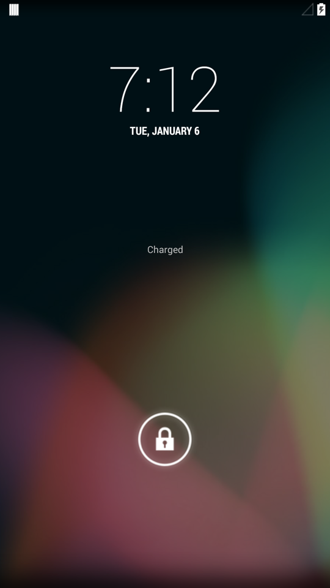

# maple 怪癖（Sony Xperia XZ Premium G8141/G8142）

> 中文译文。英文原文见 [quirks.md](quirks.md)。技术名词、代码、路径、命令与日志一律保留原文。

移植到 maple 所需的一切：硬件快照、分区布局、
kernel、阻塞清单，以及带已验证修复的完整
TEST 1–49 打通日志。状态、版本与链接见
[设备主页](README.zh-CN.md)；通用 KitKat 实战手册是
[KitKat 移植笔记](../../advanced/porting-notes/kitkat.zh-CN.md)，另有
[Donut 实战手册](../../advanced/porting-notes/donut.zh-CN.md) +
[cooper 怪癖](../cooper/quirks.zh-CN.md) 作为方法参照。

当前状态：**2026-10-15 已启动（BOOTED）** —— 4.4 kernel 上跑完整 KitKat 用户空间：
`sys.boot_completed=1`、75 个 binder 服务、Launcher 在
1080x1920 下合成、触摸可用、USB adb（`18d1:4ee7`）。**硬件加速
GL/GLES 已于 2026-10-15 验证**（Adreno 540 经 glrenderd，GLES 3.2）；**2026-10-18
图形栈换成了 [libhyb](../../advanced/software/libhyb.zh-CN.md)**（驱动在进程内、
`fbpresentd` 原子提交 —— 2026-10-18 构建、**2026-10-19 已刷入并在硬件上验证**，
TEST 49）。[`devices/maple/kitkat/`](../../../devices/maple/kitkat/) 下的设备树是带
注释、经启动验证的。剩余缺口（尚无
蜂窝/音频/相机/WiFi —— 与 cooper 早期相同的已记录限制姿态）
在文末跟踪；下面的阻塞 1–4 均已解决。

## 已确认设备状态（2026-10-13，机主报告）

- 变体：单卡（G8141）。设备树默认值（`PRODUCT_MODEL := G8141`、
  `TARGET_OTA_ASSERT_DEVICE` 首项含 G8141）已匹配。
- TA 分区已备份（DRM 密钥安全）。
- 当前运行 LineageOS（bootloader 已解锁，可用 TWRP 时代的刷机流程）。
  官方原厂（stock）转储应从运行中的 LineageOS/TWRP 经
  `scripts/dump-maple-stock.sh` 取得 —— 对分区、by-name 节点、
  framebuffer 与 density 事实仍然有效。

## 原厂转储结果（`dumps/maple-stock-20261013-213045/`）

运行 **LineageOS 20（Android 13，非官方，构建于 2024-11-17）**，
kernel `4.4.302-whatawurst+` aarch64，8× Kryo（4×0x801 + 4×0x800），平台
`msm8998`，`ro.product.device=maple`，`ro.product.board=G8141`。

- **密度：实测 410**（`ro.sf.lcd_density=410`；dumpsys Built-in
  Screen 1080×1920 @ 约 403 dpi 物理）。4K 面板在
  常规使用下渲染 1080p —— `system.prop` 现在钉住 410（此前是 480 的猜测）。
- **Framebuffer：1080×1920 @ 60 Hz，HDR10**（HdrCapabilities type 2）。
  KitKat 软件渲染打通瞄准的是这个模式，不是 4K。
- **块映射已确认**：`/dev/block/bootdevice/by-name/*`，其中
  system→sde46、userdata→sda15、cache→sda5、boot→sde35、recovery→sde36 ——
  与 `fstab.maple` 一致（路径此前已按 TWRP recovery
  fstab 修正；实测转储吻合）。
- **存在 32 位兼容**：`ro.product.cpu.abilist32=armeabi-v7a,armeabi`
  —— 运行中的用户空间带 32 位库，这对
  阻塞 1（此 kernel 上的 32 位 KitKat 用户空间）是（弱）正面信号。
- 输入：event0–event9 + mice（`system:input`，0660 类节点）。
- 缺口（脚本 bug：`run()` 把回显写进了文件；此后已修 —— 需补上
  `adb root` 步骤重跑）：`/proc/cmdline`、`/proc/partitions`、
  `/default.prop`、fb0 sysfs 节点全部返回空。

## 硬件快照（G8141 单卡 / G8142 双卡）

- SoC：Qualcomm Snapdragon 835 MSM8998（10 nm，4×2.45 GHz + 4×1.9 GHz
  Kryo 280，ARM64）+ Adreno 540。4 GB LPDDR4X、64 GB UFS、microSDXC ≤256 GB。
- 显示：5.5" IPS LCD，3840×2160 4K HDR（HDR10，801 ppi，Gorilla Glass 5）。
  Sony 常规渲染 1080p；仅 HDR 视频/相册用 4K。密度 TBD
  （参考值 `TARGET_SCREEN_DENSITY := 400`；骨架 `system.prop` 用 480
  作为待验证起点 —— 参见 cooper 的 120-vs-160 教训）。
- 原厂 OS：Nougat 7.1.1 → Oreo → Pie 9。参考设备树瞄准 10/11
  （Lineage 17.1/18.1）配 4.4 kernel（`Image.gz-dtb`）。
- 电池 3230 mAh，IP65/68，USB-C，指纹（非美版），NFC，BT 5.0，
  WiFi a/b/g/n/ac，19 MP 后摄（960 fps 慢动作）+ 13 MP 前摄。
- 代号：`maple`（单卡 G8141）/ `maple_dsds`（双卡 G8142）。
  平台：`yoshino`。bootloader 可解锁；有 TWRP + Lineage。

## 平台特性

### 分区布局（GPT/ext4，不是 BML/stl）

- boot/recovery 各 64 MB（`BOARD_BOOTIMAGE_PARTITION_SIZE 67108864`），
  system 约 5 GB、cache 约 380 MB、userdata 约 22 GB。`BOARD_FLASH_BLOCK_SIZE
  131072`（= pagesize 4096 × 32……实际是 ×64 = 262144？参考资料写
  131072 —— 需再核；按参考资料值保留，标 TODO）。
- `BOARD_KERNEL_BASE 0x00000000`，pagesize 4096，`Image.gz-dtb`。
  可直接 fastboot 刷（`fastboot flash boot boot.img`）；不像 cooper 那样要
  `erase_image` / `flash_image` 的 BML 套路。**每次刷写仍要**回读
  验证（cooper 的规矩同样适用）。
- 参考板级参数：`sony-msm8998/android_device_sony_maple`（`ten`）
  + `yoshino-common/BoardConfigPlatform.mk`（msm8998，4.4 kernel，
  `TARGET_KERNEL_CONFIG lineage-msm8998-yoshino-maple_dsds_defconfig`）。

### Kernel

- Sony 出货的 msm8998 kernel 是 **4.4** —— 比 KitKat 时代的
  3.4/3.10 kernel 新了十年。在 4.4 kernel 上跑 KitKat bionic + init，与
  在 2.6.35 上跑 Donut 属同一类问题（ueventd 节点、cgroups、SELinux 占位、
  lowmemorykiller/firmware-loader 路径全都需要审计）。
- kernel 镜像格式 `Image.gz-dtb` 晚于 KitKat 的 mkbootimg。预期需要
  mkbootimg 回移（先例：
  `patches/donut/mkbootimg-pagesize.patch`；见
  `docs/advanced/porting-notes/kitkat.md`）。

### 阻塞清单（2026-10-15 全部已解决 —— 留档备查）

1. **ARM64 SoC vs 仅 32 位的 KitKat —— 结论：可行（VIABLE）。** 32 位
   `armeabi-v7a` 用户空间（cortex-a15）能在 4.4 kernel 上跑
   （CONFIG_COMPAT）；kernel 侧唯一需要的移植是 binder
   64 位 UAPI（见下）。Modem/firmware blob 未动（尚无
   蜂窝）。
2. **工具链/容器 —— 完成（DONE）。** Trusty + JDK 6 容器
   （`containers/kitkat/Dockerfile`）、`build-jdk-openjdk6.patch`、
   `lib32stdc++6 lib32z1`、`python` 符号链接。完整 `make -j6` 全绿。
3. **显示/framebuffer —— 硬件 GL 已可用（WORKING）2026-10-15。** Adreno 540 没有
   KitKat 的 EGL/HWC，因此 EGL 经 glrenderd（在
   Lineage chroot 里跑 Adreno）走，libagl 作软件回退。glrenderd 是
   唯一的 fb0 翻页者（SF 经 rcFBPost 提交）；冷启动在
   1080x1920 下验证通过（`GLES: Qualcomm Adreno 540, ES 3.2`）。三个已修根因
   见下面的 gpu 条目与 TEST 30。显示不需要 DTB/驱动工作。
4. **存储/init —— 完成（DONE）。** GPT 按裸节点挂载
   （system→sde46、cache→sda5、userdata→sda15、persist→sda4）；
   KitKat 上 `/dev/block/bootdevice/` **并不存在** —— by-name 位于
   `/dev/block/platform/soc/by-name/` 下。全线 ext4
   （`TARGET_USERIMAGES_USE_EXT4`，被擦分区用 TWRP mke2fs）。
5. **WiFi/BT/RIL/相机/GPS。** 全是专有组件（BCM43xx + qcwcn、QCOM BT、
   MSM8998 RIL、QTI camera）。仍是 stub/通用（cooper 套路：
   `USE_CAMERA_STUB`、移除 rild、禁用 BT）—— 各 HAL 的移植是
   输入/显示之后的下一步工作。
6. **首次启动无蜂窝/音频/相机** —— 与 cooper 相同的
   已记录限制姿态（见下面的状态）。

### cooper 直接教给 maple 的东西

- 在 QCOM HAL 路径被证明之前，用 `TARGET_BOARD_PLATFORM := maple`
  （而不是 `msm8998`）—— 与 cooper 绕开 `hardware/msm7k` 是同一招。
- 密度必须实测，不能猜（cooper 120→160）。
- 每次刷写都用回读验证（cooper 的 BML 规矩，对 fastboot 同样适用）。
- Provisioning/`device_provisioned`、keymaps、`TARGET_PROVIDES_INIT_RC`、
  updater-script 参数个数 —— 均已在
  `docs/advanced/porting-notes/kitkat.md` 中为 KitKat 重新审计
  （KitKat Edify 有 `run_program` + ext4 `format`，与 Donut 不同 —— 这里比 cooper 容易）。
- blob 不进 git（`.gitignore` 覆盖 `aosp-kitkat/`、`out/`、`work/`）。

## 打通日志与后续动作
功能矩阵与版本状态：[设备主页](README.zh-CN.md)。

开机进 UI，触摸 + adb 可用（2026-10-15 —— 打通日志见 TEST 24–29）。
最新进展（TEST 33，2026-10-16）：poplar 可靠性集合 +
lights HAL + keyguard-scrim 修复已生效 —— systemui 扛住导航栏
压力测试，GL 经 glrenderd 稳在 Adreno 540，亮度/休眠正常。
构建前的工具（这些不需要服务器）：
`containers/kitkat/Dockerfile`（Trusty/JDK6，已验证）、
`scripts/dump-maple-stock.sh`（经 adb 取原厂事实 → `dumps/`，已 gitignore）、
`scripts/sync-device-tree.sh maple kitkat`（已验证）。
后续动作（日志用的复选框）：

- [x] 骨架设备树 + init/fstab 骨架（块路径已按 TWRP `fstab_maple.recovery`
      修正为 `/dev/block/bootdevice/by-name/*`，
      经实测 `by-name` 转储确认：system→sde46、userdata→sda15、
      cache→sda5）
- [x] KitKat 容器配方 + 原厂转储脚本（脚本已修：echo 写到了
      stdout，补上 `adb root` 步骤 —— cmdline/fb 缺口需重跑补齐）
- [x] 显示密度实测：**410**（实测 `ro.sf.lcd_density` + dumpsys
      1080x1920@403dpi）；`system.prop` 已钉住，framebuffer 目标 1080x1920
- [x] 构建服务器上 `repo sync` 干净（浅克隆 `--depth=1 -c --no-tags`，
      14 GB）；`lunch full_maple-eng` 通过（BUILD_ID=KTU84Q）
- [x] `boot.img` 已验证：ANDROID! magic、kernel 16744559 B（与 TWRP 转储的
      kernel 完全一致）、base 0 + 0x8000、pagesize 4096 —— KitKat
      mkbootimg 原生就能处理 `Image.gz-dtb`/base-0，无需回移。
- [x] `patches/kitkat` 首条：`build-jdk-openjdk6.patch`（接受
      OpenJDK 6；Oracle JDK 6 在 2026 年已装不上）+ 容器内的 `python` 符号链接
      与 32 位运行时库（`lib32stdc++6 lib32z1`）。
- [x] 首次完整 `make -j6`：用户空间编译通过（host tools、aidl、java）；
      仅停在 `No rule to make target vendor/sony/maple/kernel`。
- [x] wpa_supplicant 这桩公案已了：qcwcn 配置是对的（KitKat 的
      `driver_nl80211.c` 声明了 p2p/driver_cmd 钩子，而只有
      `lib_driver_cmd_qcwcn` 定义它们；通用的无驱动配置在
      `sme_*` 上挂掉，因为没人设 NEED_SME）。`lib_driver_cmd_qcwcn`
      能编译；supplicant 能链接。WiFi 在驱动移植（阻塞 5）之前仍然不可用
      —— 只是能链接。
- [x] ext4 修复：没有 `TARGET_USERIMAGES_USE_EXT4` 时，KitKat 默认
      用 yaffs2；为 system/userdata/cache 设为 ext4。
- [x] 完整镜像集 2026-10-13：`boot.img` 17 MB（几何已验证）、
      `system.img` 284 MB（稀疏 ext4，magic 正常）、`cache.img`、
      `userdata.img`。阻塞 1（MSM8998 kernel 上的 ARM32 用户空间）进入
      实弹阶段：刷机测试 + 日志采集。
- [x] TEST 1 已刷（TWRP dd，哈希已验证）→ 卡在 Sony logo，无
      USB。在构建出的 ramdisk 里找到根因：**没有 `/init.rc`**
      （`TARGET_PROVIDES_INIT_RC=true` 压掉了原厂那份，设备树
      也没提供替代）→ init 空转，零 actions/服务。
      修复：`devices/maple/kitkat/init.rc`（原厂 KitKat init.rc + `import
      /init.maple.rc`），接入 `full_maple.mk`。TEST 2 的 `boot.img`
      （17,080,320 B，已确认 ramdisk 内含 init.rc）已刷（仅 boot）。
- [x] TEST 2：kernel 已启动，init 跑了，随后 `reboot to recovery` —— ramoops
      （经 TWRP pstore 取 `console-ramoops-0`）显示 `/system` 从未挂载
      （每个服务都 `cannot find /system/bin/*`；mkdir 落到了
      rootfs）→ 根因：TEST 1 把**稀疏** system.img 原样 `dd` 了进去
      （ext4 垃圾，无法挂载）。修复：用 simg2img 转裸 ext4 推到
      `/data/media` 再 dd（5 GB，分区上验证 magic `53 ef`）。
- [x] TEST 3/4（init.rc 在场，加 kmsg 标记）：标记从不出现 ——
      init 的 `write /dev/kmsg` 观察不到（SELinux/policy），且
      `do_mount` 是**静默**失败。教训已记录，标记已移除。
- [x] TEST 5（`wait_for_coldboot_done` + 裸 sde/sda 节点 + 修正挂载
      语法 —— KitKat 要求标志以空格分隔、末尾只能有一个 options
      参数）：`/system`（sde46）与 `/data`（sda15）都挂上了，所有服务
      都找到。新的卡点：`healthd` 退出 4 次 → 25 s 时重启进 recovery。
- [x] 阻塞 1 根因（更正）：TWRP 侧的 32 位 SEGV 是环境问题
      （recovery ramdisk 缺 `/system/bin/linker`；PIE
      linker 会自己解析自身路径，缺了它便失败）。开机时
      servicemanager **没有**崩溃循环（没有 critical 消息），所以 4.4 kernel 上的 32 位
      exec 正常 —— kernel 有 CONFIG_COMPAT，刷入的内容
      持久。cortex-a15 重编保留（无论如何都是 Kryo 的正确变体），
      但不是 healthd 的修复。
- [x] TEST 6（cortex-a15 系统）：挂载保持，所有服务找到，healthd
      循环依旧。
- [x] TEST 7（独立的 mount 块 —— 在 KitKat init 里，挂载失败会静默
      中止其 action；按 cooper 先例禁用 vold + rild；加 logcat 写文件
      服务）：只有 system+userdata 挂上（cache sda5 + persist sda4 失败，
      现已隔离、非致命）。仍然没有 `on boot`（没有 logcat 文件）+ healthd 循环。
- [x] 阻塞项，2026-10-14 解决（无需审批 —— 数据早已
      没了）：`/data`（sda15）与 `/cache`（sda5）被发现完全
      清零，根本没有文件系统（kmsg 里
      `EXT4-fs (sda15): VFS: Can't find ext4
      filesystem`，blkid 空白，head + 1 MB 采样全零；
      Lineage 的 FBE 数据早已被毁，原因不明 —— 一次没有格式化的
      擦除）。只有 `/system` 挂上，rootfs 保持 ro，于是所有
      `/data/property` 写入失败，installd/keystore 卡在 `restarting`，
      启动从未完成。修复：在 TWRP 里现场把两者格式化为 ext4
      （`mke2fs -t ext4 -b 4096 -L userdata/cache`）。同一轮里的设备树修复：
      在 `init.maple.rc` 的挂载之前 `mkdir /cache + /persist`
      （这些挂载此前**静默** ENOENT 失败 —— 没有 ramdisk 目录，kmsg 里也无信息）、
      去掉无效的 `wait_for_coldboot_done`（KitKat init 没有
      该命令）、去掉重复的 `import /init.maple.rc`（全部五个
      服务都被记为忽略的重复项）、fstab by-name 路径改为
      `/dev/block/platform/soc/by-name/*`（`/dev/block/bootdevice/` 在
      KitKat 上不存在）。
- [ ] Kernel（`Image.gz-dtb`）：关键路径 —— 需要机主的 Lineage 构建
      产物。期间跑 `make -j6 systemimage` 验证用户空间其余部分。
      → 2026-10-13 已解决：从 TWRP 现场转储
      （`adb pull /dev/block/bootdevice/by-name/boot`，64 MB，ANDROID!
      magic，pagesize 4096，base 0）。Kernel（16.7 MB gzip，`Image.gz-dtb`）
      在服务器上用 abootimg 拆出 → `vendor/sony/maple/kernel`
      （带外 blob，**不入** git —— 与 cooper blob 同策略）。
      `BOARD_KERNEL_CMDLINE` 已按现场 bootimg 配置更新。
      正在跑完整 `make -j6`。
- [x] 用（修好的）`scripts/dump-maple-stock.sh` 重跑补齐缺失的
      `/proc/cmdline`、`/proc/partitions`、fb0 sysfs 节点
      → 重跑干净（无断连）；需 root 的节点在 shell 用户下仍为空 ——
      改为从 TWRP recovery adb（以 root 运行）拉取；
      没有关键项受阻。
- [x] 对原厂/TWRP 状态的 maple 跑 `scripts/dump-maple-stock.sh`；按转储
      修 `fstab.maple` + `system.prop` 密度 → 已完成
      （platform/soc by-name 路径，密度钉住 410）。
- [x] `repo init -u https://android.googlesource.com/platform/manifest -b android-4.4.4_r2` → `aosp-kitkat/`（浅克隆 `--depth=1 -c --no-tags`）
- [x] 在构建服务器上构建容器，首次 `lunch full_maple-eng`
- [x] msm8998 上跑 ARM32 用户空间的可行性预研（阻塞 1 结论）
      → 结论：可行（VIABLE，见下面 TEST 26 + binder 公案）。
- [x] TEST 8-13（binder 公案）：servicemanager/healthd 死于 binder
      WRITE_READ EINVAL。根因：KitKat 的 24 字节 binder_write_read
      （ioctl 0xc0186201）对 v8-only kernel 的 40 字节布局
      （0xc0286201）—— 再加上 v7-vs-v8 协议、4 字节 Parcel 偏移 vs
      8 字节、20 字节扁平对象 vs 24 字节。修复：
      `patches/kitkat/binder-uapi-64bit.patch`（64 位干净的 UAPI 头、
      Parcel mObjects u64 + hdr.type + 类型转换、IPCThreadState 类型转换 +
      read/writeInt64 + 8 字节偏移、servicemanager 本地结构体）。
      现场 ENTER_LOOPER res=0。完整细节见 commit message。
- [x] TEST 14：system_server 起来了，dexopt 开始。surfaceflinger 在
      eglGetDisplay 中中止（10 个 tombstone）—— KitKat 的 EGL 加载器跳过了
      libGLES_android.so。修复：`egl-use-software-renderer.patch`。
- [x] TEST 15：**不再**重启进 recovery，黑屏 + 背光亮，没有新
      tombstone，dalvik-cache 1 → 15 个 jar。启动正在推进
      dexopt。仍有一处 reply-path 写入 EINVAL（非致命；怀疑
      FREE_BUFFER/death 布局 —— 待复查）。
- [ ] 让首次启动的 dexopt 跑完（约 30-40 分钟），然后看 UI。
      → 并**未**完成：后续所有启动中 dalvik 都冻在 15 个 jar。
- [x] TEST 16-19（卡死排查）：load 钉在约 6.5，任何地方 CPU 都为零，无
      崩溃。已排除：SELinux audit 风暴（改 permissive 毫无变化）、
      存储错误（早期 kmsg 干净，TWRP 里 I/O 很快）、电池（100%）。
      Watcher 演进：loadavg → +proc 快照（toolbox `ps` 不输出任何东西，
      `sort` 在此 kernel 上 SEGV —— 两者都避开；纯 sh +
      cat/grep）→ +meminfo/dmesg（`head`/`tail` 的输出会消失，`dmesg`
      走管道会给出 debuggerd SIGPIPE tombstone —— 改为整份文件写出）
      → +每 PID 的 wchan。
- [x] TEST 20-21（wchan）：用户空间全部健康空转（binder reads、polls；
      zygote + mediaserver + netd + bootanimation 全在）。任何采样里都
      **没有** system_server —— zygote 从不 fork 它。6+ 的 load 来自
      kernel 线程，不是用户空间自旋。卡点在 system_server 完成的上游：
      PM/dexopt 冻住是因为 system_server 没完成（不是 dexopt 慢）。
- [x] TEST 22（autowinch）：`sbin/autowinch.sh` + 服务会在开机 15 分钟后
      把手机送回 TWRP —— 不用再手动按按键组合。完整的
      刷写→开机→拉取 循环现在可无人值守（除了盯屏幕）。
- [ ] TEST 24（在 TWRP 里把 userdata/cache 格式化为 ext4 之后）：重启
      进 KitKat，验证 `/data` + `/cache` + `/persist` 都能挂载，
      installd/keystore 脱离 `restarting`，system_server 出现在
      zygote 下，dexopt 越过那 15 个开机 jar。（2026-10-14 诊断中途
      15 分钟的 autowinch 触发，在 `ps`/`service list` 被采集到之前
      就把手机送回了 TWRP —— 既然 adb 已可用，考虑现在关掉
      autowinch 启动项。）
      → 部分完成 2026-10-14/15：重启显示 `/data`（sda15）**已挂载**
      （`EXT4-fs (sda15): mounted ... noauto_da_alloc,barrier=0`，不再有
      property 错误）、installd/keystore 为 `running`、`/data` 已完全
      填充、servicemanager 有应答（16 个原生服务，含
      SurfaceFlinger/batterypropreg/keystore）。system_server 现在会
      规律地 fork，并进到 PMS 的 apk 扫描（WM/AM/PackageManager 线程、
      SettingsProvider + batterystats 写入），但每一轮生命周期都在约 10 s 时死在
      `collectCertificatesLI` 的 manifest 解析中（SIGQUIT 拿 traces.txt：
      main 在 `CaseMapper.toLowerCase` ← `Attributes$Name.
      hashCode` ← `ManifestReader.readEntries` ← `scanPackageLI` ←
      `scanDirLI`），Java 层（无 tombstone，logcat 瞎），dalvik-cache
      始终为空（在 dexopt 之前就死）。Zygote 守护进程也每
      ~10-60 s 循环一次，无 tombstone/kmsg（头号嫌疑：
      ZygoteInit.main 里的 RuntimeException 路径 —— 没有 logcat 就是瞎）。
      现场用了 `stop autowinch` 拆掉 15 分钟的保险丝。
- [x] TEST 25（诊断构建 2026-10-15）：在构建服务器上加了临时文件标记
      （ZygoteInit preload/fork/death → /data/misc/zygote.txt、
      ServerThread throwable → /data/misc/syscrash.txt、PMS 每个 apk →
      /data/misc/pmscan.txt），重建 system+boot（WITH_DEXPREOPT 本就开着），
      经 TWRP 刷入（simmg2img 转裸 5 GB + 17 MB boot，两者都经 md5
      回读验证）+ 重启。手机在 `adb reboot` 之后**黑掉**了
      （黑屏、红灯、完全无 USB —— 无 adb/fastboot/枚举；
      UART 无输出），需要人工上电（没有远程手）。镜像
      经结构验证无问题（ANDROID!/sparse/ext4 magic、ramdisk
      含 usb.rc + usbudc.sh + 修好的 init 文件、标记在
      services.jar/framework2.jar 里、cmdline 保留 androidboot.hardware）。
      怀疑是电源事件而非镜像内容 —— 上电后待查（TBR）。
- [x] TEST 26（heap 修复 2026-10-15）：死亡循环的根因 ——
      每一轮生命周期里，`JarUtils.verifySignature` 在**第一个** apk
      （`/system/framework/framework-res.apk`，11.8 MB）上抛
      `java.lang.OutOfMemoryError`；build.prop 完全没做 dalvik heap 调优
      （4 GB 手机上用 Dalvik 默认值）。修复：在 full_maple.mk 里继承
      `frameworks/native/build/phone-xhdpi-2048-dalvik-heap.mk`
      （192m/512m）。结果：扫描顺利过 54 个包、
      **75 个服务，含 activity/package/window**、一次稳定的 zygote
      生命周期、零 syscrash、开机动画走完、**Android UI 出现在
      屏幕上**。WITH_DEXPREOPT 让 dalvik-cache 保持为空（设计如此）。
- [ ] TEST 27（USB-ABD 2026-10-15）：完整启动**没有** USB（gadget 从不
      bind；KitKat 的 adb 不可达）。kmsg 显示 adbd 活着但**零**条
      usbudc 行 —— 一旦 system_server 跑起来，`on property:sys.usb.config=adb`
      触发就再也不发（该 property 归 UsbDeviceManager 管）。
      修复（已入树、已刷）：在 adbd 兜底旁边无条件 `on boot`
      里 `start usbudc`。显示也出现错乱（hsync 撕裂 ——
      stride/时序；需要 adb + dumpsys/fb0 探测，等 USB 通后）。
      临时诊断已回退；服务器↔仓库再核为逐字节一致。
      → 2026-10-15 找到根因：init.maple.rc 里缺了
      `import /init.maple.usb.rc` —— 该 import（以及 usb 文件）只存在于
      构建服务器上，早前一次 repo→服务器 同步丢掉了 import 行，
      于是 usb.rc 虽被拷进 ramdisk 却从未被解析，
      `usbudc` 未知，`start usbudc` 是静默空操作。修复：import
      恢复（+ 保留无条件的 `start usbudc` 作为双保险）。
      只重建 boot、刷入、重启：**18d1:4ee7 枚举、
      adb 中出现 `maplekk device`、`sys.boot_completed=1`、75 个服务、
      /system+/data+/cache+/persist 全部挂载、Launcher 合成。**
      maple 上的 KitKat 已启动（BOOTED）。剩余：显示 hsync 撕裂、autowinch
      仍上膛（每次启动 15 分钟后重启进 recovery —— USB 可信后
      即移除）、临时诊断已回退。
- [x] TEST 28（显示 2026-10-15）：面板显示滞留的 xboot 开机图，而
      fb0 持有完美帧（launcher 解码干净）—— mdss 从不
      提交 fb0（白帧 + unblank 循环两种测试在
      视觉上都是空操作；pan 卡在 0,0）。子发现：(a) fb0 stride 是 4352 B
      （1088 px）而 gralloc 报告 1080 → 每行错切 8 px 成
      平行四边形 —— 已在 `gralloc_alloc` 中修复（对 `HW_FB` 报告
      `finfo.line_length` 的 stride；正式化为
      `patches/kitkat/hardware-libhardware-gralloc-fb-stride.patch`，
      现场推送 + 通过 fb0 解码中的反向错切验证）；
      (b) glrenderd **确实**在跑（12 fps，按正确 stride 拷贝）但
      启动时算出 `flips=0`（fb HAL 稍后才把 yres_virtual 翻倍；
      启动竞态）—— 在 fbdev 翻页也停滞时属表面问题；
      (c) 面板活体在跨启动时存在竞态（4 次观测中 2 次活过来：
      overlay 启动 vs MDP idle 塌缩/splash 交接的时序；
      见过的唯一硬错误是启动中途重启 glrenderd 时的
      `mdp ctl start failed`（EBUSY））。目前 glrenderd 保持关闭
      （去掉第二个不协调的翻页者；它的 flips=0
      启动竞态也要先修好才能回归），由 SF 独占翻页
      驱动面板。若未来某次启动冻在开机图上，优先怀疑
      这个竞态（pan 卡住 + kmsg 里 EBUSY）。基础显示不需要
      DTB/驱动工作。
      autowinch 已从设备树移除（adb 现在可信了）。
      → 2026-10-15 解决：glrenderd 不协调的 FBIOPAN 翻页
      卡住了 mdss overlay 启动（`mdp ctl start failed`，EBUSY），并
      把面板冻在开机图上。不启动 glrenderd（纯
      SF+libagl）时，面板是活的，且（配合 stride 修复）是**正确的**。
      → 2026-10-15 重新架构（charquirks 单一翻页者）：根因
      是混合模式（glrenderd 启动晚时 SF 锁定到软件路径）+
      flips=0 竞态。`start glrenderd` 移到 post-fs-data（在
      SF 探测之前），`open_panel` 自己先等再翻倍 yres_virtual。
      glrenderd 现场验证通过（listening、flips 1、无 EBUSY）。待办：
      重建 + 重刷 + 启动验证（服务器不可达）。
- [x] TEST 29（触摸 2026-10-15）：触摸到达 kernel（clearpad MT
      事件）与分发器（RecentQueue），但毫无响应。
      根因：systemui 崩溃循环（ImageWallpaper 里 `eglConfig not initialized`
      —— 需要 ES2，libagl 只有 ES1，glrenderd 又没起；
      约 1000 条 dropbox 崩溃）每轮生命周期都干掉 keyguard 窗口，而
      PhoneWindowManager 驻留一个僵尸全屏 KeyguardScrim
      （"Removing keyguard window (Did it crash?)"），吞掉所有输入。
      修复：EGL init 抛异常时让 `ImageWallpaper` 回退到 canvas 路径
      （正式化为
      `patches/kitkat/frameworks-base-systemui-wallpaper-canvas-fallback.patch`；
      APK+odex 现场推送，重启后生效）。结果：systemui
      稳定、scrim 消失、launcher 获得焦点、**触摸完美工作**。
      （触摸映射正常 —— 固件发的是全量程坐标。）
- [x] 同步审计 2026-10-15（服务器 vs 仓库）：7 个 patches/kitkat
      在两侧完全一致，**且**与现场设备树逐字节相同（反向 apply
      检查通过）；没有残留的 smdbg/bdbg。服务器曾在 4 处
      领先 —— 已拉回仓库（未提交）：`init.maple.usb.rc` +
      `usbudc.sh`（新文件，走 configfs 的 ADB 打通件）、
      BoardConfig 的 `WITH_DEXPREOPT := true`、full_maple.mk 的 usb.rc/usbudc
      行。devices/maple/kitkat 现在服务器↔仓库逐字节一致
      （kernel blob 除外）。
- [x] 后续项（由 TEST 26 解决）：zygote **确实** fork system_server ——
      早前「从不 fork」的采样是 PMS heap-OOM 死亡循环
      （每轮生命周期都在 fork 之前死在 `collectCertificatesLI`）。
      heap 调好之后，MountService/volume 等待与 reply-path 的 EINVAL
      都没有阻塞启动。
- [x] 待办项（已解除阻塞）：现场服务器上的所有改动都已正式化 ——
      `bionic-binder-uapi-64bit` + `frameworks-native-binder-64bit`
      （+ egl/glrenderd 那一组）都在 `patches/kitkat/` 里，且验证与
      现场设备树一致（反向 apply 检查）；smdbg/bdbg
      临时诊断已清除；`boot.img` 由 `make bootimage` 打包，源为
      转储的预编译 kernel（`TARGET_PREBUILT_KERNEL`，**不在** git 里）+
      构建出的 ramdisk；经 configfs gadget 的 USB adb 可用
      （`init.maple.usb.rc` + `usbudc.sh`）；无需重建 kernel
      （无 logger 环境下的日志走文件 + dropbox + debuggerd）。
- [x] TEST 23（已被取代）：15 个 jar 的卡死是 binder 64 位 ABI
      缺口（24 字节 vs 40 字节 `binder_write_read`，现已打补丁）加上
      PMS heap 大小 —— **不是**丢回包导致的卡顿。system_server 能跑，
      dexopt 不是问题（WITH_DEXPREOPT 在构建期预优化）。
- [x] 存储（可用）：内置存储是模拟存储（emulated），`/data/media` 经
      `/mnt/shell/emulated` 的 `sdcard` fuse 守护进程，以
      `/storage/emulated/legacy` 暴露，并带 `/sdcard` 链接（nexus 5
      kitkat 布局，现场验证已挂载）。overlay 的 `storage_list.xml`
      标明其为 emulated/primary。`sdcard` 以 `class main` 运行
      （挂载是手工做的、不走 `mount_all`，故不需要 `late_start`）。
      MicroSD（`sdcard1` 经 vold 挂在
      `/devices/soc/c0a4900.sdhci/mmc_host`，仅 vfat）仍未测试（UNTESTED）——
      下一项存储工作。
- [x] gpu —— 硬件加速 GL/GLES 已验证 2026-10-15（单一翻页者）：540 没有
      KitKat 的 adreno 驱动，所以用 emulator 的 GL 栈作传输层。
      `glrenderd`（在 Lineage-20 chroot 里跑 adreno）独占面板；surfaceflinger
      在宿主侧经 eglimages 合成，并通过 `glrenderd` 抽象 socket 提交
      `rcFBPost`，所以 glrenderd 是唯一的翻页者。冷启动现在直接
      跑在 Adreno 上：`dumpsys SurfaceFlinger` → `EGL implementation: 1.4`、
      `GLES: Qualcomm, Adreno (TM) 540, OpenGL ES 3.2 V@331.0`、settings/launcher
      渲染正常，一个 GLES2 shader 三角形测试光栅化并回读正确。
      五个根因，全部已修：
        (a) 两个翻页者 —— 开机后再启动 glrenderd 会让 SF 锁死在
            软件渲染器上（egl/gralloc 的模拟探测在该进程生命周期内被缓存），
            于是 SF 翻 fb0 **且** glrenderd 也翻 → `mdp ctl start
            failed`（EBUSY，面板冻在开机图上）。修复：把 `start glrenderd` 放在
            `post-fs-data`，即 SF 首次探测之前，让 SF 走 emulator 路径
            （rcFBPost，绝不翻 fb0）。charquirks 的单一翻页者设计。
        (b) flips=0 启动竞态 —— glrenderd 模式下没人打开 fb HAL，所以
            glrenderd 采样时 fb0 的 `yres_virtual` 还是单缓冲；
            glrenderd 随后只做 memcpy，从不翻页。修复：让 `open_panel`
            （tools/glrenderd/src/glrenderd.cpp）自己经
            `FBIOPUT_VSCREENINFO` 翻倍，效果与 fb HAL 完全一致（立即翻倍 ——
            先等再翻倍的版本会给 socket bind 增加约 10s，见 (c)）。
        (c) 探测窗口太短 —— 去掉无意义的等待 fb-HAL 后，glrenderd 冷启动到
            "listening" 约 0.2s；留着那步则是约 10s，SF 原本的 5s 等待就错过了
            （回退到软件路径后不再重新考虑）。修复：egl + gralloc 探测现在最多
            等 30s（`kRenderdWaitTries`/`kWaitTries` = 300）。
        (d) 翻页 ioctl 选错 —— glrenderd 用 `FBIOPAN_DISPLAY` 翻页；maple 的
            `mdss_mdp_overlay_pan_display` 会打印 `unable to allocate base pipe`
            并返回 SUCCESS 但不移动偏移，于是 fb0 持有正确帧而面板
            始终不变（截图看着正常，面板是黑的）。修复：用
            `FBIOPUT_VSCREENINFO` + 新的 `yoffset` 翻页，正是能工作的原厂
            gralloc 的 `fb_post` 所做的。（关于 `set_par`「重做整个模式」的
            移植注释来自 pdx203 的 drm 路径，不是这条 fbdev 路径。）
        (e) mdss 空闲掉电 —— DT 里的 `qcom,mdss-idle-power-collapse-enabled`
            会在显示空闲时给 MDP 断电；面板随后变黑（背光暗、无扫描输出），
            下一次翻页被卡住，于是静态 UI 在触摸之前一直消失。
            修复：从每个追加 DTB 里剥掉该 property
            （scripts/patch-maple-dtb.py，即 pdx203-jellybean 的修复）。
            已在设备上验证：UI 现在能常驻。
      ES2 缺口已补上：hwui/动态壁纸的 ES2 现在可用（这条路径上不再只有
      canvas 回退；glrenderd 停掉时 `ImageWallpaper` 的 canvas 回退仍留作
      安全网）。glrenderd 缺席时，libagl 软件回退仍能渲染出
      正确的 1080x1920 UI。glrenderd 的设计（移植自
      [pdx203-jellybean](https://github.com/chardidathing/pdx203-jellybean)，
      作者 @chardidathing）：emulator 的 gl 库经 `glrenderd`
      抽象 socket 流式传给守护进程（32 位，跑在 lineage 20 的
      system+vendor chroot 里），后者在 adreno 上绘制、回读、翻 fb0。
      构建：先打上四个 `*glrenderd*` 补丁，然后
      `tools/glrenderd/build.sh $AOSP_DIR <android-ndk-r21e>`、
      `tools/glrenderd/extract-lineage.sh <lineage 20 maple zip>
      <sysroot> [oem.img]`、`tools/glrenderd/stage.py <sysroot>
      tools/glrenderd/out $AOSP_DIR/vendor/sony/maple-glr`（oem ==
      lineage vendor；zip 若已不在就从 TWRP 转储）。协议
      自 4.2 未变；守护进程按 KK sdk 构建。
      Kernel blob：把 `Image.gz-dtb` 转储到
      `vendor/sony/maple/kernel` 之后，运行
      `scripts/patch-maple-dtb.py vendor/sony/maple/kernel`，从追加的 DTBs 里
      剥掉 `qcom,mdss-idle-power-collapse-enabled`
      （需要 `dtc`）；blob 在 git 之外，所以该补丁不会
      自动应用。之后由 `make bootimage` 打包打补丁后的 kernel。
      构建服务器备注：NDK r21e 现已装在 `~/android-ndk-r21e`
      （从 dl.google.com 取；构建脚本需要它 + 宿主 C++
      编译器 + python3）。
      **已知偶发**（与 GL 无关）：KitKat 的 keyguard 极少见地会卡进
      已记录的僵尸 `KeyguardScrim`（`KeyguardViewManager`/PhoneWindowManager
      里的开机/解锁竞态，不是 GL）。keyguard 窗口 add 会抛一次
      `BadTokenException: another window of this type already exists`，
      随后 `removeWindowLw` 显示 scrim，UI 就被卡在它后面，直到
      重启。若干次启动里约 1 次复现；非 glrenderd 引起（同样的循环
      在它之前就有）。恢复办法：息屏/亮屏（`input keyevent 26` 两次）会重新触发
      keyguard 的 `onShown` → `hideScrim`，现场就清掉了；重启也行。
      非安全 keyguard 用 MENU 解锁（`input keyevent 82`）。真正的修复是
      WMS/keyguard 的竞态，尚未动手。
- [x] 触摸与按键（触摸 2026-10-15 实测可用）：clearpad
      在 post-fs-data 里 `post_probe_start` 之后探测（同 lineage）；
      `clearpad.idc` + 全量程固件坐标 1:1 映射（不需要
      缩放修复）；带上 `gpio-keys.kl`（音量键分发
      已验证：RecentQueue 里 keyCode 24）；电源键经 qpnp_pon +
      Generic.kl；导航栏开启（`config_showNavigationBar`）。两段式
      相机键（528/766）未测试（UNTESTED）。
- [x] TEST 30（硬件 GL，2026-10-15）：把 glrenderd 拉起为默认
      渲染器，并端到端验证了 Adreno 540 上的 GLES 3.2。
      证据：`dmesg` → 4.95s 时 `glrenderd: starting (pid N)`、`doubled fb0
      virtual to 1080x3840`、`panel 1080x1920 stride 4352 flips 1`、5.19s 时
      `listening on @glrenderd`；`dumpsys SurfaceFlinger` → `EGL implementation
      1.4`、`GLES: Qualcomm, Adreno (TM) 540, OpenGL ES 3.2 V@331.0`、flips
      持续增长；一个 ES2 pbuffer 测试（`test_3d`：红底清除 + 蓝色 shader
      三角形）回读 20808 个三角形像素 / 44728 个清除像素，`glGetError=0`；
      Settings 渲染正常、fb0 解码干净。修复（全部入树）：
      `start glrenderd` 移到 post-fs-data（在 SF 缓存的模拟探测
      之前 —— 干掉双翻页者的 EBUSY 卡死）、`open_panel` 立即翻倍 fb0 的
      yres_virtual（没有别人做这件事 —— 干掉 flips=0 竞态）、
      以及 egl/gralloc 模拟探测改等 30s（glrenderd 的 bind 在冷启动时慢；
      5s 会错过，SF 就整轮生命周期锁在软件路径）。
      另外：构建服务器上重装了 NDK r21e（`~/android-ndk-r21e`）；
      `frameworks-native-egl-glrenderd.patch` + `device-generic-goldfish-
      glrenderd.patch` 更新为 300 次重试等待；glrenderd 重建并
      现场推送（`/system/glr/root/glrenderd`、`/system/lib/libEGL.so`、
      `/system/lib/libOpenglSystemCommon.so`、`gralloc.maple.so`）；boot.img
      重刷（start-in-post-fs-data，回读验证）。测试二进制
      （`test_egl*`、`test_3d`）留在 `/data/local/tmp`。另有
      一处独立的偶发 keyguard-scrim 竞态见上文（不是 GL）。
- [x] TEST 31（面板呈现，2026-10-15）：GL 已经能用，但物理
      面板显示昏暗/黑图，而 fb0 与截图持有正确
      帧。两个独立原因，都已修：
      (d) glrenderd 用 `FBIOPAN_DISPLAY` 翻 fb0；`dmesg` 显示
      `mdss_mdp_overlay_pan_display: unable to allocate base pipe`（ioctl 返回
      成功，偏移从不移动）。能工作的软件路径所用原厂 gralloc
      用 `FBIOPUT_VSCREENINFO` + `yoffset` 翻页；把 glrenderd 改成这套
      之后，`/sys/class/graphics/fb0/pan` 开始翻转，base-pipe 错误消失。
      (e) `qcom,mdss-idle-power-collapse-enabled` 让 MDP 在空闲时断电
      → 面板黑到被触摸为止。已从全部 4 个追加 DTB 里移除
      （`scripts/patch-maple-dtb.py`，与只改该 property 的手工 dtc
      往返结果验证逐字节一致）、重建 boot.img
      （回读验证）、重刷。结果：UI 现在常驻面板
      （机主确认）。另外学到：`mDisplayReady=false` 与
      `idle_power_collapse` sysfs 字符串都是不可靠指标；有活动时
      `/sys/class/graphics/fb0/pan` 里的偏移翻转才是真信号。
      本测试期间设的临时诊断已回退（锁屏保留、
      `screen_brightness` 回到 102、`stayon false`）。
- [x] TEST 32（GL 工作之后重启造成的开机卡死 + 冻结取证 + poplar 修复集，
      2026-10-16）：TEST 30/31 之后机主重启了设备；机器卡在 Sony bootloader 的
      开机画面上，**USB 完全没有反应**（没有 18d1/0fce/05c6，usbmon 静默）。来
      自 TWRP 的事实：这次失败的启动什么都没写（`dmesg-boot.txt` / `watch.txt`
      的 mtime 未变 —— bootlog 根本没跑过），`/sys/fs/pstore` 为空，
      `/proc/last_kmsg` 不存在，boot 分区回读 md5 == 服务器上的 `boot.img`（`3f0f8a7d…`）
      → 刷进去的内容是完整的；卡死属于 userspace 之前的状态，不是内容问题。与
      TEST 25 同类（重启后无 USB 的死启动；需要物理上电开机）。**恢复办法：在
      TWRP 里直接 `adb reboot` → KitKat 18 秒起来**（adb 能枚举；glrenderd
      4.98 s 开始启动 / 5.19 s 开始监听）—— 在重刷任何东西之前先试这个。
      - 分诊规则：「卡在开机画面」按 USB 状态分成两类：adb 还活着 + 画面不动 =
        显示交接卡住（TEST 28 那一类，系统已经起来）；**完全没有 USB =
        userspace 之前就挂了**；走一趟 TWRP 往返来恢复；别指望 pstore（强制断
        电会在 TWRP 读到 ramoops 之前把它丢掉）。
      - 冻结取证（为什么会重启）：上一次会话跑了约 9.6 h；在设备时间约
        13:43/13:59，systemui 的主线程永远阻塞在 `SocketStream::readFully` 里
        的 `recvfrom` 上 —— 一次经由 `eglInitialize`/`rcQueryEGLString_enc`，
        一次经由 `Surface::lock` → `gralloc.maple.so` →
        `rcColorBufferCacheFlush_enc`。glrenderd 停止应答，而没有上界的 socket
        等待把一个渲染器的小抽动变成了永久冻住的 UI（Watchdog 内核 dump 在
        U+33528/33625/33721/33818 s；SYSTEM_RESTART dropbox 13:44；ANR
        13:43/13:59）。
      - 收到 poplar（XZ1）的修复集 —— 同一套 MSM8998/Adreno
        540/emugl-glrenderd 架构。Zip：
        `reference/poplar-kitkat-gpu-fixes-2026-10-16.zip`（sha256 `9effee3a…`；
        里面 `GPU-FIX-AND-QUIRKS.md` = 完整记录，`source/` 是打好补丁的源码，
        `patches/` 是编辑脚本，还有 poplar 专用的参考二进制）。maple 这套可靠
        性修复一样都没有：
        - (A1) fork 安全 —— TLS 的 GL 连接会跨 zygote fork 被继承下来，于是好
          几个进程共享同一个 socket（帧界定丢失）。修法 = 在
          `HostConnection::get()` 里按 pid 重新认领一个 file-static 连接；绝不
          新增成员变量（inline 的 `alloc()`/`flush()` 偏移已经烧进预编译的 enc
          库）。
        - (A2) glrenderd 启动时把 `/proc/sys/net/core/{r,w}mem_max` 提到 16
          MiB —— 默认的 208 KB 会静默地把大 buffer 掐小，让整帧推送卡住。
        - (A3) **有界应答 + 重连 + SIGPIPE** —— `SO_RCVTIMEO`（默认 20 s，可用
          `persist.glr.replytimeout` 调整），超时/EOF/EPIPE ⇒ 标记为 dead，就
          地重连（绝不 free：会 use-after-free —— 他们的 `fix_reconnect.py` 是
          修正后的设计；`fix_wedge_FIRST-DESIGN-DO-NOT-USE.py` 是陷阱），发送
          时带 `MSG_NOSIGNAL`，dead 状态的 `writeFully` 返回 0（要是返回失败，
          会把预编译编码器 memcpy 进去的 buffer 置 NULL）。这修的就是上面那次
          冻结。
        - (A4) 给 `GLConsumer.cpp`（libgui）里的 `glGetError()` 清错循环加上界——
          每次迭代都是合成线程上的一个 socket 往返。
        - (A5) 渲染器侧：`ReadBuffer` 上限 32 MiB + 丢弃客户端，`RenderThread`
          一次只解码一条已声明的消息 + 帧界定诊断（`FRAMING LOST`/`RESYNC`/
          `NOPAYLOAD`、`[glr-rt] client pid=`），丢弃时调 `shutdownStream()`。
          需要在 host 侧的 IOStream/SocketStream 上补 `peerPid()`/
          `shutdownStream()`（这个 bundle 没有附带那处改动）。
        - gralloc：lock 时跳过 `rcColorBufferCacheFlush` 往返 —— host 侧是个空
          stub，但它会阻塞 app 的 UI 线程；它就在我们的 ANR 栈里。
        - C2：`InputDispatcher` 的冻结解冻（10 s），用于死掉的窗口切换造成的派
          发冻结（libinputservice）；B8：`lights` HAL —— maple 压根没有 lights
          模块（`/system/lib/hw` 下没有 `lights.*`；亮度和休眠都需要它）；B9：
          KeyguardScrim 的 no-op/焦点标志（maple 有 canvas 回退，但没有 scrim
          补丁）。
      - 不要跨设备照搬（每条结论都是在各自的硬件上验证的）：poplar 用
        `FBIOPAN_DISPLAY`，但 maple 的 TEST 31 证明 FBIOPAN 在这里是不搬移的空
        操作（「unable to allocate base pipe」），真正能翻页的是
        `FBIOPUT_VSCREENINFO` + yoffset —— 保留 maple 的做法。poplar 期望 fb0
        的虚拟高度事先已经翻倍；maple 的 glrenderd 必须自己把 `yres_virtual`
        翻倍（flips=0 竞态，见 TEST 30）—— 保留 maple 的做法。A6 直接回读（把
        回读直接写进 panel page）：不要移植；poplar 试过并回滚了（开机卡死 /
        画面花屏）。渲染器重编译规则：`glrenderd` 的构建会重新生成 codec 表；
        单独部署一个重编译出来的渲染器会出现偏暗/花屏 —— 要么用同一棵源码树重
        编 guest 的 `*_enc.so`，要么继续用已知可用的那个二进制。
      - 移植前的备份：设备上 `/data/local/tmp/glr-fix-backup-20261016/`，服务
        器上 `~/glr-backup-20261016/` —— glrenderd `c88c3883…`、gralloc.maple
        `5088dd12…`、libOpenglSystemCommon `e8953e41…`（都做过服务器↔设备的
        md5 确认），libgui `6a18ca67…` / libinputservice `3a0b9ed8…`（服务器副
        本已留；设备侧 md5 回读仍为 TODO）。
      - 后续（NEXT）：一次把 A1–A5 + gralloc + C2（+ lights HAL）全部移植完，
        推送，只重启一次，然后做长时间 GL 浸泡，盯 `recvfrom` 一类的卡住（现在
        都不该超过应答超时）以及保持为 0 的 `FRAMING LOST`。→ 已在 TEST 33 完
        成。
- [x] TEST 33（移植 poplar 可靠性修复 + lights HAL + scrim，2026-10-16）：
      A1–A5 + gralloc + C2 整套修复、lights HAL 和 scrim 修复都已移植、编译、
      部署，并在真机上验证（一次批量推送，只重启一次；服务器和设备两侧都留了备
      份）：
      - (A1) `HostConnection.cpp`：在 `get()` 里按 pid 重新认领连接（file-static，
        不是类成员 —— inline 的 `alloc()`/`flush()` 偏移已烧进预编译的 enc 库）。
      - (A3) `SocketStream.{h,cpp}`（guest + sdk 两份副本）：`SO_RCVTIMEO` +
        `SO_SNDTIMEO` 20 s（属性 `persist.glr.replytimeout`），每次发送都带
        `MSG_NOSIGNAL`，超时/EOF/EPIPE ⇒ 标记 dead + **关闭 fd**。MAPLE 在
        poplar 之上额外做的：poplar 发布的 bundle 从不关闭 socket，于是
        `valid()` 一直为 true、`reconnectIfDead()` 永远触发不了 —— 要让重连设
        计真正生效，这个 close 是必需的；另外，往 dead 流上写会把命令丢掉却报
        成功（如果返回失败，就会把 `IOStream::alloc()` 返回的、编码器要往里
        memcpy 的那个 buffer 置 NULL）。
      - (A3) `RenderdStream.{h,cpp}`：就地重连，限频 1/s；`kWaitTries` 保持
        **300**（30 s —— maple 冷启动需要整个窗口，poplar 用的是 50）。MAPLE
        额外做的：重连时必须重放每连接的握手字（`clientFlags=0`，4 字节），
        `RenderServer::Main` 在开始解码之前会先读它 —— 首次连接从
        `HostConnection::get()` 拿到，重连就得自己发；不发的话渲染器会把第一条
        GL 命令当成 clientFlags 吃掉，或者触发 `IOSTREAM_CLIENT_EXIT_SERVER`
        退出。
      - (A4) `GLConsumer.cpp`（libgui）：两个 `glGetError` 清错循环的上界设为
        8 —— 每次迭代都是一次同步往返。
      - (A5) host `ReadBuffer.cpp`：上限 32 MiB，满了又没有进展就丢弃客户端（旧
        代码会一直翻倍到约 2 GB，把渲染线程搞死）。host `RenderThread.cpp`：每
        个解码器一次最多给一条已声明的消息，帧界定丢失时重新同步，把 12 MiB 的
        滚动流历史 dump 到 `/dev/glr-stream-<pid>.bin`，打印
        `[glr-rt] client pid=` 和 `dropped (getData=)`。需要在 `IOStream` 上加
        `peerPid()`/`shutdownStream()` —— 只加在 host/sdk 副本里，且追加在所有
        已有虚函数之后，这样 guest 的 vtable 槽位不会移位；`SocketStream` 用
        `SO_PEERCRED` + `SHUT_RDWR` 实现它们。poplar 的 bundle 没有附带这两个
        方法。
      - gralloc（`gralloc.maple`）：`lock()` 跳过 `rcColorBufferCacheFlush` 往
        返（host 侧是个空 stub，但它是同步往返，会排在繁重的 GL 工作后面，把
        systemui 的 canvas 绘制堵住 —— 就是记录到的两次 `recvfrom` ANR 之一）。
      - (A2) `glrenderd`：启动时把 `net.core.{r,w}mem_max` 提到 16 MiB，并忽略
        `SIGPIPE`，这样 guest 在应答中途死掉也带不走守护进程。
      - (C2) `InputDispatcher`：解除持续超过 10 s 的派发冻结（WMS 会在窗口切换
        前后冻结派发；如果切换永远完不成，派发器就永久睡下去、UI 什么触摸都收
        不到）；证据在 `/data/system/dispatch-thaw.log`。
      - (B8) 新增 `vendor/sony/maple/lights/`（模块 `lights.maple`）：亮度同时
        写到 `/sys/class/leds/lcd-backlight` 和 `/sys/class/leds/wled` —— 两个
        节点互相独立（实测：写一个不会改变另一个），TWRP 是通过 wled 驱动背光
        的，而 AOSP 的惯例是 lcd-backlight。另外加了
        `TARGET_PROVIDES_LIBLIGHT := true`，并在 PRODUCT_PACKAGES 里加
        `lights.maple`。
      - (B9) 让 `KeyguardServiceDelegate.showScrim()` 变成空操作，并把 scrim
        窗口设为 `FLAG_NOT_TOUCHABLE|FLAG_NOT_FOCUSABLE`，这样即使 keyguard 死
        了也吃不下所有输入（僵尸 scrim 卡死问题）。
      - 补丁：从源码树重新生成 `device-generic-goldfish-glrenderd.patch` 和
        `sdk-glrenderd.patch`；新增
        `frameworks-native-glconsumer-glgeterror-bound.patch`、
        `frameworks-base-input-dispatch-freeze-thaw.patch`、
        `frameworks-base-keyguard-scrim-no-input.patch`。
      在设备上验证（只重启一次）：
      - glrenderd：`rmem_max`/`wmem_max = 16777216`、`doubled fb0 virtual`、
        `listening on @glrenderd`、`[glr-rt] client pid=` 行、一条
        `dropped (getData=-1)` 之后 **6 ms 后**就出现新的 `client pid=`（就地
        重连路径确实被触发），`FRAMING LOST`/`RESYNC` 均为零，整个会话内
        glrenderd 零重启。
      - surfaceflinger：`GLES: Qualcomm, Adreno (TM) 540, OpenGL ES 3.2` —— 经
        glrenderd 走硬件 GL，没有软件回退。
      - navbar 压测（18 次 home/切 app 的 keyevent）：systemui 的 pid 不变，没
        有新的 drops，没有 watchdog/tombstone 活动。
      - lights HAL：`settings put system screen_brightness 200` → 亮屏时两个节
        点都读到 3211，休眠时读到 0 —— 真正的背光控制（在这个 HAL 之前，
        framework 根本碰不到面板）。
      - 已知坑点（本来就存在，只是这次才看得见）：Keyguard 窗口设了
        `userActivityTimeout=10000`（AOSP 的 `AWAKE_INTERVAL_DEFAULT_MS`），所
        以只要这个窗口在，WMS 就把息屏超时压在 10 s —— 闲置约 10 s 后屏幕就黑
        了。它不是卡死；按电源键能唤醒。除非机主觉得烦，否则先不动它。
      - 坑点：设备上的 KitKat toolbox 没有 `head`/`tail`/`sed`/`pidof` —— adb
        一行命令只能用 `grep`/`cat`/`ls`/`ps`。
      - 渲染器重编译规则被遵守：glrenderd 是从产出已部署 `*_enc.so` 的同一棵源
        码树重编译的（codec 表从没改过的 `.in` 文件重新生成）—— 面板起来正常。
- [x] TEST 34（动画性能审计 + socket buffer 修复，2026-10-16）：机主问「硬件加
      速是 100% 吗？有些动画有点卡」。结论：是，各处都是 100% 硬件加速；卡的原
      因是模拟链路里的每帧延迟 —— 没有软件回退，也没有资源被打满。事实与这次收
      紧的地方：
      - 硬件检查：surfaceflinger 的 GL = 「Qualcomm, Adreno (TM) 540, OpenGL
        ES 3.2」，经 glrenderd 提供（哪儿都没有 libagl）；即便在放动画，GPU 也
        待在最小时钟（257 MHz，0–19% 占用）；8 个 CPU 全钉在最高频（governor
        为 `performance`，1.9/2.45 GHz）；没有东西跑飞（UI 闲置时 `top` 显示所
        有进程都是 0%）。
      - 帧路径埋点现在常驻在 glrenderd 里：每第 60 次 present 会紧挨着
        readback/copy/flip 打印 `posts= drops= postgap stage`。postgap = guest
        的帧间隔，drops = 面板没能看到的帧数，stage = 渲染线程 memcpy 进
        presenter 槽的那一段。
      - 每呈现一帧（实测）：readback（glReadPixels）8.7–10.0 ms，stage 1.3–2.7
        ms，copy（presenter 线程，并行）2.5–10.4 ms，flip 0.7–9.6 ms。所有测过
        的窗口里 drops 都是 0 —— present 路径从来不是限制项。
      - 真正的限制是 guest 的帧节奏（postgap）：纯窗口动画约 20 ms/帧（50 fps
        的爆发），需要 app 重绘的帧（锁屏圆环拖动、settings 滑动、launcher 抽
        屉）40–60 ms/帧（17–25 fps），开机动画约 30 fps（它 zip 自身的目标帧率）。
        这期间 CPU 和 GPU 都在闲置 ⇒ 节奏由跨模拟层串行化的同步往返决定（swap
        fence、BufferQueue 交接、socket 往返），不是算力。要再提升流畅度必须针
        对这些同步点（见下面的选项清单）。
      - 修掉了 poplar 文档里写过却从未发布的 socket 限幅：
        `net.core.{r,w}mem_default` 是 **212 992（208 KB）**，而一帧的 GL 命令
        流轻松就有几百 KB —— guest 会在帧中途阻塞在 `send()` 里，与渲染器串行
        化。只调高 `{r,w}mem_max`（TEST 33）还不够：现在两端每条连接都真的
        `setsockopt(8 MiB)` —— host 侧在 `UnixStream::accept()`（tools），
        guest 侧在 `RenderdStream.cpp` 的连接/重连处（`glrSetSocketBuffers`，
        两份 SocketStream.h 副本里都有声明）。启动窗口没有回归（第一个窗口改前
        改后都是 7.2 fps/50.6 ms）；负载噪声把干净的 A/B 对比盖住了（见下一条
        注记）。
      - 测试方法的教训：`input swipe` 连发是个噪声很大的基准（一次报告需要 60
        个呈现在面板上的帧；静止的 UI 永远凑不满 —— 这里几次「no data」其实只
        是屏幕黑着/睡着了）。要用持续动画并读多个窗口，或者直接给 guest 的
        swap 频率加埋点。另外：这个移植上 `screencap` 返回的是一张恒定的白图（截
        屏路径坏了）—— 真相在 `/dev/graphics/fb0`（把 1080×1920 的两页都 dump
        出来，stride 4352 B，按 1088×1920 RGBA 解码再裁到 1080；launcher/锁屏
        的状态就是这么确认的）。锁屏在 (540,1477) 的解锁圆环是个很方便的可重复
        动画源；僵尸 Keyguard 窗口可以在 launcher 可见时仍然持有 FOCUS（触摸仍
        按位置路由，所以屏幕内的 navbar 能用，但 `input keyevent 3` 不行）。
      - 如果还想要更流畅，可选方案（大致按收益排序，都还没做）：(a) 异步/PBO
        双缓冲回读，把 9–10 ms 里的大部分藏到下一帧后面（会多约 1 帧延迟）；
        (b) 直接回读到 presenter 槽（poplar 的 A6），省掉 2 ms 的 stage 和一趟
        8.3 MB 的内存搬运；(c) 给 guest 的 swap/fence 路径加埋点（BufferQueue
        深度、KHR_fence_sync 等待），它看起来才是真正卡 app 帧的关口；(d) 以半
        分辨率呈现，UI 最顺（回读+copy 减半；代价是变糊，由机主决定）。
- [x] TEST 35（poplar A6 + 异步回读试验 + swap 埋点，2026-10-16）：机主说：「还
      是有点卡，特别是 launcher3 和滚动；把 poplar 剩下的 GL 修复和我提的那些
      方案都实现，半分辨率除外」。已完成：
      - **A6 已移植**（poplar GL 里最后缺的一项）：post 回读现在直接落到
        presenter 槽，而不是 FrameBuffer 的 buffer ——
        `FrameBuffer::setPostReadback()` + glrenderd 里的 `present_acquire()`
        + `ColorBuffer::readbackTo()`（文档里「不要回读进 panel page」的警告被
        遵守了：只写槽，绝不碰 fb0）。真机实测：每帧 `stage 0.0 ms`（原来是
        1.3–2.7 ms）；同口径的启动窗口从 9.8 ms 的 readback+stage 降到 8.9 ms，
        而且每帧省掉一整趟 8.3 MB 的内存搬运。测试脚本：每个上报窗口里
        `drops=0`。
      - **异步 PBO 回读已实现，但被实测否掉**：藏在
        `persist.glr.asyncreadback` 后面（运行时可切，不用重启）。同一个抽屉滑
        动激励下的实测结果：**13.1 fps / postgap 76 ms，而同步路径是 31–35 fps
        / 29–32 ms**；SF 的 swap 阻塞时间从 11 ms 跳到 58.6 ms —— PBO 的
        map+copy 比它想藏起来的同步回读还贵（回读的发起确实降到 0.1 ms，但 map
        连本带利还回去了）。默认关闭；管线留着给以后的试验用。
      - **swap 路径埋点**（host 侧，按连接）：一次 window-surface swap 是
        `rcFlushWindowColorBuffer` → queue/dequeue → `rcSetWindowColorBuffer`；
        每 60 次 swap 记录一次这个间隔。在持续激励下实测：surfaceflinger 每帧
        在自己的 swap 里阻塞 **10.7–11.9 ms**（framebuffer buffer 的释放要等上
        一次 post，也就是 host 的回读算在这个数字里），动画期间它的 compose/等
        待间隔是 **17.0–26.4 ms**。这个构建上的持续帧率：**抽屉翻页 31–35
        fps**（postgap 29–32 ms）、**settings 列表滚动 26–28 fps**（postgap
        35–39 ms）；各段耗时：readback 9.1–10.5 ms、presenter copy 5.0–11.7 ms、
        flip 1.1–3.9 ms。app 客户端（launcher、settings）从来不出现在 swap 日
        志里 —— 它们的 swap 应该走的是另一套 op（很可能是 v2 window-surface 路
        径），所以如果要 app 侧的数字，还得在那里也加埋点。
      - **值得记住的测量陷阱**（今天每一条都真的浪费了时间）：(1) fb0 的像素是
        RGBA —— 全零帧是*透明黑*，把它存成 RGBA PNG 看起来会是白的；解码时先加
        `format=rgb24` 再下结论；(2) 最后一次输入之后约 10 s 屏幕就休眠（keyguard
        窗口的 `userActivityTimeout`），而且**触摸唤不醒它** —— 每个测试都必须
        先查 `mScreenOn` 并用 power/menu 键唤醒，否则这个「测试」是在睡着的屏
        幕上跑的；(3) Launcher2 的抽屉会记住标签页，它的 WIDGETS 标签页在这里
        渲染是空白的 —— 先查 `dumpsys activity top`（view flags）再怪管线；(4)
        这个移植上的 `screencap` 返回恒定图像 —— 用 fb0 dump；(5)
        `input keyevent 26` 是开关切换：先看状态，别假设。
      - 给机主的结论：poplar 的 GL 那套现在**全部移植完成（A1–A6）**。UI 动画
        能持续跑到约 26–35 fps；剩下的开销在模拟链路的每帧同步路径上（回读 +
        buffer 释放 ≈ 11 ms，加上 compose/等待 ≈ 18–26 ms）。异步试验说明回读
        没法轻易藏起来；下一批候选（尚未做）是 app 侧 v2-surface op 的埋点和
        guest 的 fence/queue 路径。
- [ ] TEST 36（wifi + audio 打通，2026-10-16，进行中）：机主要求参照
      `reference/CHARQUIRKS.md`（pdx203 的 4.2 移植）来做 wifi 和 audio。先在
      设备上诊断，再改源码树；除标注 LIVE 的之外，下面内容都还没在设备上验证过。
      - LIVE 事实（adb、`maplekk device`、`sys.boot_completed=1`）：audio：
        `/proc/asound/cards` = 「--- no soundcards ---」，`/dev/snd/` 里只有
        `timer`，`dmesg` 显示「No soundcards found」，
        tavil/tasha/wcd/slim/qdsp 的 probe 行一条都没有（只有 TDM DAI 在 probe），
        `/sys/kernel/debug/asoc/{codecs,dais,platforms}` 也是空的 —— machine
        driver 在悄悄 defer。DT 里同时有 `sound-tavil`（`qcom,model=msm8998-tavil-snd-card`，
        真正的那张卡）和 `sound-9335`，两边都带布尔型的 `qcom,wcn-btfm`（0 字
        节属性）和 `qcom,wsa-devs`（16 B）+ `qcom,wsa-max-devs`；codec 挂在
        `slim@171c0000`（tavil_codec/tasha_codec）下，wcn3990 挂在
        `slim@17240000` 下。运行中的内核（`/proc/config.gz`，
        `4.4.302-whatawurst+`，2024 年 11 月）把所有东西都编进去了（`CONFIG_SND_SOC_MSM8998=y`、
        WCD9335+WCD934X、WSA881X、QDSP6V2、APRV2_GLINK、PDR、
        `CONFIG_MSM_SERVICE_LOCATOR=y`、`CONFIG_QCA_CLD_WLAN=y` 内建 ——
        lineage-17.1 defconfig 里的 `=m` 已经过时）。cmdline 上有
        `service_locator.enable=1`；
        `audio_notifer_reg_service: SSR_MODEM is in use`；7 个 msm_subsys（ipa_fws
        venus spss a540_zap adsp slpi modem）全部处于 SYSTEM；
        `/system/vendor/firmware` 里只有 glr 暂存的 a5xx GPU 固件；ADSP 的 PIL
        加载从未被尝试过（只有 5.14 s 时的 a540_zap）。wifi：qca_cld3 内建，驱
        动 v5.1.1.77V 已加载，`/dev/wlan` 为 chr 229,0，
        `/sys/module/wlan/parameters/fwpath` 存在但为空 —— 可是没有 wlan0，没
        有 `/sys/class/ieee80211` phy，`/proc/net/wireless` 为空。
        `wlan.driver.status=unloaded`，supplicant 从未跑过。根因都在 userspace
        （两处都已在源码树里修掉）：(a) `/data/misc/wifi/sockets` 和
        `/data/misc/dhcp` 从未创建（只有 softap.conf 存在）；(b) 任何地方都没
        有定义 `wpa_supplicant` / `p2p_supplicant` / `dhcpcd_*` 服务，所以
        wifi.c 的 `ctl.start wpa_supplicant` 是个静默空操作。
        `lib_driver_cmd_qcwcn` 是静态链接的（被链进 wpa_supplicant —— 它不在
        `/system/lib` 里是对的，不是 bug）。`echo ON > /dev/wlan` 创建不出接口；
        手工跑 wpa_supplicant 因为没有 wiphy 就直接静默退出（得先完成 WLFW/QMI
        固件握手 —— modem 侧 `wlanmdsp.mbn` 在 modem 分区上有，但这里的 modem
        从来没起来过）。modem 分区（vfat 的 `image/`，实测以 ro 挂载）里带
        `adsp.*`、`bdwlan.*`（+`.bin`）、`cpe/wcd`、`slpi_v*`、`venus.*`、
        `wlanmdsp.mbn`；bluetooth 分区带 cherokee BT（`crbtfw*.tlv`/
        `crnv*.bin`）；`/persist/wlan/wlan_mac.bin`（32 B）存在。`dmesg` 里还
        有 `ipa_smmu_wlan_cb_probe: could not alloc iommu domain`（新 ini 里的
        `gIPAConfig=0` 就是因此而来）。
      - 源码树改动（本次改动，编译 + 刷机 + 验证都还没做）：wifi 的
        `init.maple.rc` 加上 sockets/dhcp 目录、两个 supplicant 服务 +
        `dhcpcd_*`（照 hammerhead 的写法，class main —— 没有 mount_all 时
        late_start 永远不会触发），以及 adsp/slpi 的 RELATED 写入（subsys4/5——
        顺序已在设备上验证）；BoardConfig 里 `service_locator.enable=0`（CHARQUIRKS
        的 audio 结论：设成 =1 时那张卡要经 pdr 花约 5 分钟才起来，cmdline 里
        设为 0）；修正了 BoardConfig 里错误的 wifi 注释（WCN3990/cherokee 的
        qca_cld3，不是 BCM43xx —— 由 `/proc/config.gz` + BT tlv 名字证明），并
        记录下 CHARQUIRKS 在 `BOARD_WLAN_DEVICE` 上的分歧（仍保留 qcwcn：
        KitKat 的 driver_nl80211 必须链上这个私有库才能 LINK）；新增
        `vendor/sony/maple/wifi/`（最小化的 `WCNSS_qcom_cfg.ini` 带
        `gIPAConfig=0`，两个 `*_overlay.conf` stub）和
        `vendor/sony/maple/audio/`（`audio_policy.conf`、来自 sony-msm8998 ten
        的 `mixer_paths_tasha.xml`、`audio.primary.maple` 这个 tinyalsa HAL：
        扬声器 = `speaker` + 深缓冲 MM1/pcm0，麦克风 = `handset-mic`/dmic1 +
        MM1/pcm0，DEC7 104（+20 dB，不用 acdb），卡不在时静默安全，另为录音加
        了 `libsrec_jni`）；`scripts/patch-maple-dtb.py` 现在还会剥掉布尔型的
        `qcom,wcn-btfm`（相当于把 CHARQUIRKS 的 `qcom,wcn-bt = <0>` 翻译过来——
        已在真实 blob 上验证：4 个 DTB 全都 -38 B，mdss 修复完好，tavil
        model 完好，可重复执行）。固件 blob（adsp.*、bdwlan.*、wlan_mac.bin）
        刻意不进 git（与内核 blob 相同的「不入库」策略）—— 提取 + 暂存是这个镜
        像启动起来之后的下一步。
      - 后续（需验证，按顺序）：(1) 重刷后看卡是否 probe（`/proc/asound/cards`
        出现 tavil；若仍没有，下一个怀疑对象是 WSA881x 在 defer —— DT 里带着
        wsa-devs/max-devs，却一条 wsa/swr probe 日志都没有）；(2) 通过新 HAL
        测扬声器 + 麦克风；(3) WLFW 固件问题有答案后再走
        `setprop ctl.start wpa_supplicant` 这条路径（可能被 modem 卡住 —— 这个
        移植上 modem 从来不启动，和蜂窝/GPS 是同一堵墙）。
      - 挫折 2026-10-16（同一会话内修掉）：带新 HAL + policy 的第一次启动让
        mediaserver 反复崩溃重启（SIGSEGV fault addr 0，位置
        `AudioFlinger.cpp:1349`，`loadHwModule` → pc 0，共 10 个 tombstone；
        `init.svc.media=restarting`，没有 boot_completed）。根因：HAL 没有给
        `init_check` 赋值（也没有任何 stream getter）—— framework 能碰到的每个
        op 都必须赋值，见新增的实战手册教训。修法：在 `audio_hw.c` 里补齐整张
        ops 表（device + 两个 stream 的 common + out/in 各自的具体项，用
        `-ENOSYS`/中性默认值），与通用 stub 对齐。只重编 HAL + 在线推送。
      - 已验证 2026-10-16（修完之后，只重启一次）：修好的 HAL 在线推送后，
        `sys.boot_completed=1`，`init.svc.media=running`，mediaserver 的 pid
        稳定 5 分钟以上，没有新的 tombstone。`boot.img` 已在设备上验证：
        `/proc/cmdline` 里 `service_locator.enable=0`，4 个 DTB 里的
        `wcn-btfm` 都没了，init 创建了
        `/data/misc/wifi/{sockets,wpa_supplicant.conf,entropy.bin}`。
        `setprop ctl.start wpa_supplicant` 现在能解析了（oneshot 退出后是
        `stopped` —— 之前是空白/未知）；它退出是因为 wlan0 依然不存在（WLFW 握
        手，下一步）。卡还是 `--- no soundcards ---`（内核那条线的工作），
        wlan0 仍然没有（WLFW/modem 的问题）。
      - 跟进 2026-10-16（同一会话，机主反馈：拨号和音量键都没声音，Settings 里
        看不到 Wi-Fi）：两个都在设备上解释了。音频：AudioFlinger 跑的是我们自
        己的 primary output（dumpsys：48000 Hz 输出线程，HAL frame count 1024；
        policy dump 显示的是我们的采样率）—— 链路一路通到 HAL 的静默安全丢弃，
        所以没声音恰好就是缺内核那张卡，没有别的原因。Wi-Fi：
        `/system/etc/permissions` 里一个 feature xml 都没带，于是
        PackageManager 把 Wi-Fi 从 Settings 里藏了起来；补了
        `android.hardware.wifi.xml`（frameworks 源码，一行 PRODUCT_COPY_FILES——
        按 CHARQUIRKS 的处置不加 p2p xml）。推送 + 重启后 feature 被授予，
        整条开关路径都跑通了：`svc wifi enable` → WifiStateMachine 的
        DeviceActiveState → wifi.c → `wpa_supplicant` oneshot 跑起来又退出（没
        有 wlan0）。Settings 现在能看到 Wi-Fi；扫描/连接要等内核接口。
      - TEST 37（SKIP_QMI 实验，2026-10-16）：把 `icnss.quirks=388`（SKIP_QMI
        + defaults）烧进一个测试 boot.img，想绕开 QMI WLFW 握手强行让 HDD
        probe。结果：卡在 Sony logo 反复重启（userspace 之前，内核 panic 那一
        类）—— 通过 TWRP 重刷之前的 boot.img 恢复（`/data/media` 里的
        `boot-test36.img`，设备侧 md5 校验 `c31321cb…`，热重启后回到
        `boot_completed=1`）。教训：这个旁路确实生效（启动时会跑 probe），但没
        有 QMI 提供的初始化设置就崩；要抓 panic 得在整轮循环里保住 pstore（没
        做）。cmdline 标志已在源码树里回退。剩下的 wifi 路径：在 64 位 Lineage
        chroot 里跑 cnss-daemon（真正的 QMI 握手），或者让 modem 启动。
      - TEST 37b（SKIP_QMI + BDF 重测，2026-10-16）：第一次 SKIP_QMI 可能只是
        缺 board data 才崩，所以把 test37 的完整组合都刷了进去 ——
        `system-test37.raw.img`（5 GB，md5 `4b8539ac…`，dd 之后按分区校验过；
        内含 FW_DIR 的接线：adsp.* + cpe_9335.* + bdwlan.* + wlan_mac.bin + 测
        过的 HAL）加上同一个 quirks boot.img。结果：一模一样的反复重启（110 s
        后仍无 adb，两次都这样）。没有 QMI 的初始化设置，SKIP_QMI 不管 BDF 配
        成什么都行不通 —— 已回退，不再重试。恢复待办（机主明天才回来）：TWRP →
        把 `/data/media/boot-test36.img`（`c31321cb…`）dd 到
        `/dev/block/bootdevice/by-name/boot`，重启。test37 的 system 分区保留
        （好事：FW 接线 + HAL 都留在那儿）。这个教训是撞出声的：覆盖正在运行的
        system 分区会把活着的 libc 弄坏（`CANNOT LINK EXECUTABLE ... empty/missing DT_HASH`）——
        推送、校验，然后立刻重启，其间不要再跑任何东西。
      - Audio DSP 卡住（TEST 36 的后续）：tasha 卡已经起来，24 个扬声器控制项
        通过静态编译的 `tone_test`（`tools/tone_test.c`，NDK r21e armv7a，静态
        链接 tinyalsa）验证全部 SET，但播放停在 PREPARED，日志是
        `msm_pcm_playback_copy: wait_event_timeout` —— ADSP 是 ONLINE 却不返回
        任何 buffer。首要嫌疑：音频保护域（这个移植上没有 pd-mapper/adsprpcd；
        Lineage 两个都有，还带 rmt_storage 和 tftp_server）。这次探测没有产生
        新 tombstone（唯一一个新 tombstone 是 toolbox 里 `ls|grep` 的 SIGPIPE，
        已知噪声）。
        **2026-10-19 已解决（TEST 50）：这不是保护域问题。**
        ADSP 一直是在线的；它缺的是 ACDB 校准（内核的 cal 块来自
        某个 userspace 加载器），而 HAL 只写了每个 buffer 的四分之一
        （KitKat 的 tinyalsa `pcm_write` 收的是字节数）。不需要任何
        `adsprpcd` —— 见本文件末尾的音频打通日志。
      - QRTR 结论（2026-10-16，定论）：`/proc/kallsyms` 里 `qrtr` 符号一个都没
        有（阳性对照通过：binder 409、msm_ipc_router 58、qmi_handle 12），
        `/proc/net` 里没有 qrtr，配置里只有遗留的 `CONFIG_IPC_ROUTER` + 内核内
        部 QMI。后果：任何现代 QMI userspace（pd-mapper、cnss-daemon、
        rmt_storage、tftp_server —— Lineage vendor 里全是 64 位 QRTR 客户端）
        在这个内核上都跑不了，chroot 也不行。64 位 chroot 另外还走不通：哪儿都
        没有 `linker64`（APEX payload 是单独发的；`sysmnt/apex` 是空的）。走遗
        留传输确实能用的有：内核 QMI（sysmon-qmi 已在线触达 ADSP SSCTL）、SMD
        FastRPC（`/dev/adsprpc-smd` 存在 —— adsprpcd 的通道）和 PIL。所以音频
        PD 这条路，如果有的话，只能走 adsprpcd-over-SMD 或 HAL 内加载 ACDB（`/dev/msm_audio_cal`
        存在；服务器上暂存了 7.9 MB 的 `maple-fw/acdbdata`），绝不能靠 QRTR 守
        护进程。同一个结论也否掉了 cnss-daemon chroot 的想法 —— wifi 剩下的路
        是 modem 启动或者内核 QRTR 后向移植（各自都是一条独立的线）。
      - QRTR 后续（2026-10-18，从 dumps 做的静态复查）：
        上面结论的内核那一半依然成立（没有 CONFIG_QRTR），
        但「任何现代 QMI userspace …… chroot 也不行」这个说法
        太强了，而「哪儿都没有 linker64」看的是错的那一份。
        Lineage 22.1 自己的 vendor `libqmi_cci.so` 是双传输的 ——
        `strings` 里既有 `qcci_ipc_router_ops` 也有 `qcci_qrtr_ops`，
        还带一个运行时的 "QRTR NOT SUPPORTED/SUPPORTED" 探测 ——
        而 `cnss-daemon` 链接了它，所以 libqmi_cci 客户端可以回退到
        `pdserve` 已经在用的那套遗留 IPC-router 传输（TEST 40）。
        而 Lineage 的 system 镜像里确实带着
        `system/bin/bootstrap/linker64`（2,188,552 B 的 aarch64 ELF；
        早先的探测看的是手机上挂载的活体视图，那里的 apex 是分开的）。
        那六个守护进程（cnss-daemon、pd-mapper、rmt_storage、
        tftp_server、irsc_util、sensors.qti）全是 aarch64 ELF，
        `interpreter /system/bin/linker64`；传输划分：
        cnss-daemon、pd-mapper、sensors.qti（`libqmi_cci`）和
        rmt_storage（`libqmi_csi`，同样是双传输）属于候选，而
        tftp_server 直接链接 `libqrtr.so`，出局。所以 cnss-daemon
        chroot 这个想法重新回到了桌面上（WLFW 正是 wifi 缺的那一半）；
        只有设备才能回答 libqmi_cci 的遗留路径是否能完成握手。
        无论如何 `pdserve` 仍然取代 `pd-mapper`；逐子系统评估见
        Taimen 对照页（§"The daemon chroot and the HAL bridges"）。

## 打通日志：service locator + pdserve（2026-10-17）

- **TEST 39（service_locator.enable=1，modem 先起，adsp 在 modem 之后）：**
  boot_completed 约 25 s；modem 在约 6 s 时 ONLINE；adsp-boot 在 2 s 后看到
  modem ONLINE，写入 `boot_adsp`；`/proc/asound/cards` 显示
  `msm8998-tasha-snd-card` —— **locator=1 没有带来音频回归**。locator 那 5 个
  卡住的 `pd_locator_work` kworker（audio_pdr、icnss、slimbus、ath10k、+）就是
  那道闸：内核在等一个 SERVREG_LOC（QMI 0x40、vers 1、instance 0x0101）服务器，
  而这个移植上没有任何东西提供它（原厂 64 位的 `pd-mapper` 需要 64 位 userspace；
  见 2026-10-18 的 QRTR 后续 —— `pdserve` 仍是这个移植的方案）。
- **pdserve**（`devices/maple/kitkat/pdserve/pdserve.c`，静态 musl armv7，现已
  作为 `pdserve` 进入 `PRODUCT_PACKAGES`）：一个 32 位的 SERVREG_LOC 提供者，
  走 `AF_MSM_IPC`（SOCK_DGRAM，family 27），绑定名字
  `{service=0x40, instance=0x0101}`，并从 modem 分区的 `.jsn` 表（modemuw.jsn、
  modemr.jsn、adspua.jsn、adspr.jsn）读取数据来应答 `GET_DOMAIN_LIST`（消息
  0x21）。设备上验证：`servloc: ... Service locator initialized`，并且内核连上
  了 instance 74（adsp）和 180（modem）的 servreg-notif 服务。modem 自己的 TMS
  是这个服务器的客户端（对 `tms/pdr_enabled`、`tms/pddump_disabled`、
  `kernel/elf_loader`、`wlan/fw`、`avs/audio` 的请求都会到达并被应答）。
- **未解阻塞 —— modem 稳定性：** modem 会触发自己的 err-fatal 中断，并且每约
  41 s 重启一次（`subsys-restart: ... Restart sequence requested for modem`，
  失败原因 `smem_get_entry_no_rlock failed`）。这早于 pdserve（TEST 39 里从
  t=46 s 就能看到），与 locator 无关。后果：WLAN PD 永远起不来（没观察到
  `wlfw`/`wlan0`），因为 modem 的 root PD 在 servreg-notif 注册完成约 3 s 后就
  崩了。怀疑原因：这个移植上没有 rild/keepalive（官方原厂是靠 `vendor.qcrild`
  让 modem 保持活着）；没有 AP 侧的 QMI 客户端，modem 的 watchdog 就会咬。下一
  步是用 64 位 chroot 跑 `vendor/bin/hw/qcrild`（或者一个最小化的 QMI
  keepalive）。在那之前，Wi-Fi 打通代码本身是对的、也确实解开了 PDR 链，但没法
  端到端验证。
- **待修（下一个 boot 镜像）：** `adsp_boot` 不是 oneshot，所以 `adsp-boot.sh`
  每约 5 s 就重跑一次；把它改成 `oneshot`（已在 `init.maple.rc` 里改好）。另外
  把 audio HAL 的修复（`audio/audio_hw.c` 里的 `stop_threshold = INT_MAX`）烤
  进下一个 system 镜像。

## 打通日志：全新镜像上的 GL 可靠性（2026-10-17）

- **TEST 41（机主：「硬件加速 GL 只是有时候能用」—— 要一直全速；2026-10-17）：
  ** 找到并修掉了三个叠加的缺陷，用冷启动加上一轮崩溃/重启压力矩阵验证。
  - **全新镜像丢掉了 chroot 里的空目录，于是 SF 锁死在软件渲染上。** 症状：从
    开机起就个位数 fps，`init.svc.glrenderd=restarting`；dmesg 里
    `hwchroot: bind /dev -> /system/glr/root/dev: No such file or directory`；
    `/dev/block/sde46 /system ext4 ro`。根因：`full_maple.mk` 用
    `find . -type f` + `PRODUCT_COPY_FILES` 来暂存渲染器 chroot，这样带不了
    `stage.py` 会建的那些空目录（`dev`、`proc`、`sys`、`data/...`）；hwchroot
    运行时再 mkdir 就在只读分区上 EROFS 失败，每个 bind 都拿到 ENOENT，
    glrenderd 反复重启，而 surfaceflinger 那个一次性的硬件 vs 软件探测（等 30
    s，结果按进程锁定）就掉到软件渲染器上。修法：`hwchroot` 改为从 `/dev/.glr`
    上一个可写的 tmpfs 骨架来组装 chroot（通用入口 bind，先绑 /dev，再补合成目
    录），而不是在 `<root>` 里 mkdir —— 日志戳是
    `hwchroot: assembled /dev/.glr from /system/glr/root`。冷启动验证（最终
    hwchroot md5 `24adff33…`）：约 4.9 s 组装完成，SF 报告
    `GLES: Qualcomm, Adreno (TM) 540, OpenGL ES 3.2`，开机动画 28–37 fps，
    `posts=60 drops=0` 稳定。
  - **镜像里还带了一个过期的守护进程 —— guest 和 server 两半来自不同构建。**
    `/system/glr/root/glrenderd` 还是 A1–A6 之前的二进制（md5 `c88c3883…`，
    162320 B，统计行里没有 `posts=`），而同一个镜像里的 guest 库是新的（证据：
    `/system/lib/libOpenglSystemCommon.so` 里带着
    `glr-guest: reconnecting to the renderer`、`persist.glr.replytimeout`）——
    可靠性修复做完之后，server 的暂存目录一直没刷新。这个不匹配在使用 5 分钟内
    暴露出约 3 次守护进程崩溃（FORTIFY
    `pthread_mutex_lock called on a destroyed mutex (0xf3ef332c)`；
    `glBindTexture+29` 里的 `signal 11 at 0x20`；经 `glTexSubImage2D` 进到
    `EsxContext::TexImage` 的 `signal 11 at 0x4`），都发生在客户端掉线、面板切
    换前后。修法：用当前源码重编（`tools/glrenderd/build.sh`；md5 `bcb4ab7a…`，
    170668 B），部署，并刷新暂存树，让镜像发出去的两半是同一批。判断跑的是哪个
    守护进程：新构建会打印 `posts=… drops=… postgap … stage …`。验证：做同样的
    压力（启动 settings 并滚动、翻页/划抽屉、熄屏亮屏循环、守护进程停/起折腾）
    → **0 次崩溃**，动画窗口按激励不同在 12–35 fps。
  - **重启过的守护进程会让活着的 surfaceflinger 悬在那里：** 新起的守护进程对
    SF 的窗口对象没有任何 server 侧状态，所以在新实例下 `posts=0`，而 SF 还在
    翻它那些过期的 buffer（guest 的就地重连不会重建窗口对象）。恢复办法是
    `setprop ctl.restart surfaceflinger`（`service_restart`，
    `system/core/init/init.c:400`：running → stop+start，not running → start，
    restarting → 空操作）—— 已验证：SF 的 pid 变了，重新探测到 Adreno，帧恢复。
    这把 init.maple.rc 里「在线 `stop glrenderd` 之后需要重启 surfaceflinger」
    的注记推广到了每一次守护进程死亡。
  - **hwchroot 里自愈（不需要额外的 watchdog 服务）：** /dev 这个 tmpfs 上的一
    个标记文件（`/dev/.glr/ran`）记录「本次启动守护进程已经跑过」；本次启动内
    只要有第 2 次及以后的 hwchroot 运行、并且守护进程二进制存在，hwchroot 就自
    己 fork 出 host 的 `/system/bin/setprop ctl.restart surfaceflinger`，然后
    再 exec 守护进程。冷启动不受影响（第一次运行是 init 从 post-fs-data 里发起
    的）。没有做限频：init 自己的崩溃-重启退避（`time_started + 5`、
    `restart_service_if_needed`、init.c:418）本来就把崩溃循环的周期拉到 ≥5 s，
    而压制自愈反而会让最后活下来的那个实例悬着。设备上验证：
    `stop/start glrenderd` → 自愈 + SF 重新探测 + 帧恢复；对守护进程
    `kill -ABRT` → init 重启 → 自愈（服务一回来 SF 的 pid 就变了）→ 帧恢复；冷
    启动 → **没有**自愈日志行。
    - **做这个时抓到的陷阱：绝不要用「SF 在不在跑？」当重启信号。** 开机时
      post-fs-data 的 `start glrenderd` 在 hwchroot fork 出去后立刻返回，init
      马上就会执行 `on boot` 的 `class_start core` —— SF 的进程只比 glrenderd
      的晚几毫秒出现（第一次尝试把一个才约 10 ms 大的 SF 踢了：「daemon
      restart」在 4.87 s，替换的 SF 到 9.86 s 才起来 = 正好是 5 s 退避；这个竞
      态就是这么发现的）。运行次数标记才是诚实的信号；SF 的 GL 探测要几秒之后
      才发生，那时 glrenderd 已经在监听了。
  - 运维笔记（每条都花了一次启动周期）：替换 `/system/glr/hwchroot` 直接 push
    即可（运行中的进程镜像是 `/glrenderd`）；替换 `/system/glr/root/glrenderd`
    会碰上 `Text file busy`，必须先 `stop glrenderd` —— stop → cp → chmod 755
    → `sync` → 重新挂载 ro → `start`。验证部署上去的身份要用 md5，不要用时间戳。

## 打通日志：Donut USB adb（2026-10-18）

- **TEST 42 —— FunctionFS 描述符数据必须用这个内核的古老 magic 值
  （`1` / `2`），而不是现代的 `0x502` / `0x503`。**
  - 症状：在 Donut 启动里，adbd 每秒重试一次 `open ep0` + `write
    descriptors`，永不停歇（`/cache/adbd-ffs.log`：`write
    descriptors len=62 FAILED ret=-1 errno=22`），内核从不打印
    "read strings"，gadget 也从不绑定 —— 每约 6 s 一条 `configfs-gadget
    a800000.dwc3: failed to start g1: -19`（在 strings 写入把
    `desc_ready` 置上之前，`ffs_do_functionfs_bind` 一直返回
    `-ENODEV`）。`kmsg` 里只有 init 那次 `functionfs: file system
    registered`，此外什么都没有。
  - 诊断：f_fs 的 QCOM IPC 日志
    （`/sys/kernel/debug/ipc_logging/f_fs/log`，需要挂 debugfs）
    四行就说清了全部：`ffs_ep0_write: enter:len 62 state 0` →
    `__ffs_data_got_descs: enter: len 62` →
    `__ffs_data_got_descs: exit: ret -22` → `ffs_ep0_write: exit:ret
    …594`，中间**没有**任何 `ffs_do_descs` 条目。`ffs_do_descs` 之前只跑
    两项检查：长度字段和 magic；长度是对上的（62 = 62），所以被拒的是
    magic。
  - 根因：我们的数据是按现代枚举生成的
    （`#define FUNCTIONFS_DESCRIPTORS_MAGIC 0x502`），但 whatawurst 的
    msm8998 4.4 树保留的是古老那套 ——
    `include/uapi/linux/usb/functionfs.h`
    （`android_kernel_sony_msm8998`，lineage-21）：
    `FUNCTIONFS_DESCRIPTORS_MAGIC = 1`、`FUNCTIONFS_STRINGS_MAGIC = 2`、
    `FUNCTIONFS_DESCRIPTORS_MAGIC_V2 = 3`。对 0x502 来说 `switch
    (get_unaligned_le32(data))` 走 `default: goto error` —— 在任何
    描述符日志之前就 `-EINVAL`。TWRP 的 adbd 在同一个内核上能跑，是因为
    它带的就是这些值：它 `init_functionfs` 的 `.rodata` 模板是
    `[magic 1, length 62, fs_count 3, hs_count 3]`（V1），先试
    `[magic 3, length 0x90, flags 0xf, …]`，strings 用
    `[magic 2, length 32, str_count 1, lang_count 1]`。
  - 不重启的现场验证：在 TWRP 活着的那份旁边另开一个*测试* ffs 实例 ——
    `mkdir /config/usb_gadget/g1/functions/ffs.test`（绝不要碰
    `ffs.adb`）、`mkdir -p /dev/usb-ffs/test`、
    `mount -t functionfs test /dev/usb-ffs/test`，然后
    `exec 3<>/dev/usb-ffs/test/ep0`（**必须**是 `<>`；用 `O_TRUNC`
    打开会失败）再 `cat blob >&3`。magic 1/2 → write 返回数据长度，日志里
    是完整的 `ffs_do_descs` / `ffs_do_single_desc` /
    `__ffs_data_do_entity` 解析，外加
    `ffs_epfiles_create: … eps_count 2`，挂载点里出现 `ep1`/`ep2`。
    magic 0x502/0x504 → 同样一行 `exit: ret -22`。
    **读 ipc 日志会把日志消费掉** —— 只读一次，紧接在 write 之后，
    否则证据就没了。
  - 修复：`patches/donut/system-core-adbd-ffs.patch` 现在把
    `FUNCTIONFS_DESCRIPTORS_MAGIC 1` / `FUNCTIONFS_STRINGS_MAGIC 2`
    设好（并附了说明原因的注释）。2026-10-18 验证：刷入带修好的 adbd 的
    boot.img（前缀 md5 匹配），`adb reboot` → 约 30 s 后主机枚举到
    `mapledonut device` —— 一条真正的 adb 传输，而此前每次尝试只看到
    TWRP 的 `recovery`。
  - 后续（同一个 TEST，当晚稍后 —— 「手机消失了」的解释）：诊断构建的
    `usbudc.sh` 是个解绑 + 重绑的循环（`echo "" > $UDC`；sleep 3；
    `echo a800000.dwc3 > $UDC`），永远跑下去，而且只*记录*
    `bind FAILED rc=0 err= eps=[]` —— rc 和空的 `eps` 都是读回竞态：
    QCOM configfs 的 bind 是异步的（write 返回了，gadget 约 0.4 s 后才
    起来），所以同一瞬间读 UDC 永远是空，而下一轮的解绑又把刚刚建立的
    连接拆掉。主机的 `journalctl -k` 可以作证：`maple-donut` 每 6 s
    连上 → 断开，42 个周期（11:52–11:57），设备号 119–160；手机侧 kmsg
    每个周期都有对应的
    `configfs-gadget gadget: high-speed config #1: b`，而
    `failed to start g1: -19` **一次都没有**。240 s 的 autowinch 随后在
    抖动中途重启回 recovery（`mdss_fb_release_all: … name=reboot`），
    17 s 后主机又看到 TWRP。修法：`usbudc.sh` 改用 KitKat 移植验证过的
    语义 —— 轮询 UDC，读到空才 bind，**绝不解绑**（adbd 掉 gadget 时仍
    需要重绑：关掉 ffs 实例本身就会解绑）。设备上验证（2026-10-18）：
    adb 枚举成 `mapledonut device` 并可用；抖动这件事的解释有主机日志 +
    手机 kmsg 双重支撑。
  - 后续 2（同一个 TEST）—— **某次启动完全没有 USB 的真正原因：Donut 的
    shell 里没有 `[`。** 下一次启动用的 `usbudc.sh` 把 bind 卡在
    `[ -z "$(cat $UDC)" ]` 上。Donut 的 `/system/bin/sh` 没有 `[`/`test`
    —— 内建和二进制都没有 —— 所以每个 `[ ... ]` 都打印 `[: not found`、
    返回非零，并悄悄走 **else** 分支。脚本的 `while [ $i -lt 600 ]` 一
    次迭代都没跑：kmsg 里只有一行 usbudc，`usbudc: bind FAILED after 0
    tries rc= err=` 出现在 2.840 s，整个启动里 `configfs-gadget` 相关行
    为零，900 s 的 autowinch 把手机送回 TWRP（2026-10-18 12:39）。之前
    对这次启动提出的「第一次 bind 撞上了 adbd 的 ep0 建立过程」这个理论
    是错的 —— UDC 根本没被写过。发现方式是从 TWRP chroot 进 Donut 的
    `/system`，用 Donut 自己的 shell 跑那个随镜像发出的脚本；能力清单与
    通用教训在
    [donut.zh-CN.md](../../advanced/porting-notes/donut.zh-CN.md)。这次
    （错误）理论顺手产出的 ep1 闸门脚本和状态感知 autowinch 已经删掉 ——
    见后续 3。
  - 后续 3（同一个 TEST）—— **对 Donut shell 安全的脚本是可行的：gadget
    绑定一次就一直在；之后 `adb shell` 还需要再修一处（也修掉了）。**
    `usbudc.sh` 重写成只用退出状态判断：先等 12 s，然后每 3 s 执行一次
    `cmp $UDC /cache/usbudc-unbound >/dev/null
    2>&1 && echo a800000.dwc3 > $UDC`，每次尝试再向 `/dev/kmsg` 打一个
    tick；参照文件里放的正是未绑定状态下 UDC 的内容。这份内容在设备上用
    Donut 自己的 shell 对着一个活着的*未绑定* gadget 验证过
    （`mkdir /config/usb_gadget/testg`，从不绑定，TWRP 的 `g1` 不碰）：
    未绑定的 UDC = 1 个字节 `"\n"`（cmp rc 0 → 绑定），已绑定的 UDC =
    `a800000.dwc3\n`（rc 1 → 跳过），而
    `echo "" > /cache/usbudc-unbound` 能逐字节复现未绑定的内容。飞行
    记录（2026-10-18 12:45 那次启动）：kmsg `usbudc: start` 2.897 s、
    tick 1 14.899 s、`configfs-gadget gadget: high-speed config #1: b`
    15.450 s、之后每 3 s 一个 tick —— 没有解绑、没有重绑、没有 `-19`；
    主机 dmesg 只有一条
    `new high-speed USB device … 18d1:4ee7 … maple-donut`（设备 37），
    整个会话一直挂着，`adb devices` → `mapledonut device`。
    - `adb pull`（sync 服务）立刻可用；`adb shell <cmd>` 接受了请求
      （客户端侧记录：`shell:<cmd>` 之后马上 `OKAY`），然后永远挂住。
      根因**不是**传输层：`service_to_fd` 的 `const char* args[2]` 是一个
      局部数组，交给了服务线程（stack-use-after-return），于是 exec 出来的
      子进程是光秃秃的 `/system/bin/sh`，**没有 `-c`**，就一直在等 stdin。
      在没有 shell 的情况下，靠 `adb pull` 把 `/proc/<pid>/cmdline`
      （15 字节 = 只有 `/system/bin/sh\0`）、`/proc/<pid>/wchan`
      （`pipe_read`）和 `/proc/<pid>/syscall`（`3 …` = `read(0, …)`）
      抓出来诊断的；pid 取自 bootlog 快照，当时正开着一条很长的
      `adb shell sleep 60`。
    - 修复（patches/donut/system-core.patch）：在 `service_to_fd` 里
      `strdup()` 命令，在 `shell_service` 里拼 `-c <cmd>` 参数，子进程
      退出时 `free()`；`reboot:` 里同样的潜在缺陷（参数指向已释放的
      OPEN 包）用同样的方式修掉。验证 —— **2026-10-18 13:01 已验证**
      （boot.img md5 `e6ee2096b22c4956dd152f38dc681d98`，dd 刷入，17 MB
      前缀读回匹配）：`adb shell echo hello-donut` → `hello-donut`、
      `adb shell id` → `uid=0(root) gid=0(root)`、stderr 会合并
      （`echo out; echo err >&2` 两条都回来）、连续三次独立的 shell 会话
      成功、`pull`/`push` 不变。同一次启动的 USB 故事很干净：
      `usbudc: start` 2.837 s、tick 1 14.840 s、
      `configfs-gadget gadget: high-speed config #1: b` 15.449 s、之后
      每 3 s 一个 tick、零 `-19`、主机只枚举一次。shell 起来后从主机把
      autowinch 杀掉（对每个 `/system/bin/sh` 的 pid `cat`
      `/proc/<pid>/cmdline` 找到它），会话才能活过 15 分钟。

## 打通日志：Donut system_server 崩溃 + 原子操作（2026-10-18）

- **system_server 崩溃循环的根因 = 弱序多核 CPU 上没有屏障的 bionic
  `__atomic_*`。** Donut 的
  `bionic/libc/arch-arm/bionic/atomics_arm.S` 用 LDREX/STREX 重新实现了
  `__atomic_cmpxchg/inc/dec/swap`，但**省掉了原 kuser 辅助函数提供的完整
  内存屏障**。`cutils/atomic.h` 写明了契约（"all reads or writes issued before
  android_atomic_* operations are guaranteed to complete before the atomic
  operation takes place" = 全屏障）。在 4 核 Cortex-A73
  （MSM8998，AArch32 兼容模式）上，这会破坏 bionic pthread mutex 和
  libutils `futex_mutex` 的互斥（两者都调 `__atomic_*`），并间接影响
  Dalvik 的加锁。症状：system_server + acore 崩溃循环
  （3 分钟 10 个 tombstone，2026-10-18 16:49–16:52）、`abort ←
  mspace_free ← dvmHeapSourceFree ← sweepBitmapCallback ← ... ←
  gcForExternalAlloc`（堆损坏）以及 `free ←
  SharedBuffer::release ← ~String16 ← Parcel::writeInterfaceToken`
  （fault 0x0d）。对照实验：`msptest 3`（4 线程 × 100 万次迭代，
  CAS 自旋锁 + 受保护的计数器 + malloc churn）在老 libc 上 = SIGSEGV
  rc=139，修好后 PASS。修法：在全部四个 `__atomic_*` 函数里，每个
  LDREX/STREX 前后都加 `dmb sy`（`.word 0xf57ff05f`）；同时把 libcutils 的
  `android_atomic_swap`（仅剩的那一个 `swp`）也重写成 LDREX/STREX+dmb。
  验证：`msptest 3` 和 `msptest 4`（原子一致性）在 TWRP 内核（4.4.263）和
  Donut 内核（4.4.302）上、配修好的 libc
  （md5 `2b6469277b6c4375849ea3c0d96f85d3`）和 libcutils（md5
  `af710d64a95e0936f8841de6f37afe44`）都 PASS；基线（无屏障）的
  `msptest 3` 在两个内核上都 = SIGSEGV。
- **这个内核上有 kuser 辅助函数**（`CONFIG_KUSER_HELPERS=y`、
  `CONFIG_COMPAT=y`）；kuser 页映射在 0xffff0000，版本字是
  0x00000005。基于 kuser 的 `android_atomic_*`（libcutils，全屏障）一致性
  全过。此前「kuser/页缺失」的假设是错的：真正作祟的是 `swp`，不是缺页。
- **SWP 模拟是开的**（`CONFIG_SWP_EMULATION=y`）—— `swp` 被模拟执行
  （慢，不致命），所以最初的崩溃是缺屏障导致的堆损坏，而不是指令故障。
  没有模拟时 `swp` 在 ARMv8 上会陷入；LDREX 重写彻底避开了这个依赖。
- **第二道拦路虎：`com.android.phone` 在锁屏上 OOM。** 堆还停在 Donut 的
  默认值（16 MB 增长上限）时，锁屏图案壁纸的位图（28 KB 外部分配）把预算
  撑爆了：`dalvikvm-heap: 28900-byte external allocation too large for
  this process` → `LockPatternView.getBitmapFor` 里的
  `OutOfMemoryError: bitmap size exceeds VM budget` → `UnlockScreen` 上的
  `InflateException`（Binary XML line #60）→ WindowManagerPolicy 线程死亡
  → `ViewRoot.setView` 处主线程 NPE（ViewRoot.java:428）→
  `I/Process: Sending signal … SIG: 9` → zygote 退出 → init 重启 zygote →
  崩溃循环。修法：在 `BoardConfig.mk` 里设
  `USE_CUSTOM_RUNTIME_HEAP_MAX := 512m` —— Donut 的 dalvik 忽略
  `dalvik.vm.heap*` 这些 prop（那是 Honeycomb 及以后才有的发明），只从
  `-Xmx` 读最大堆、默认 16 m（除非定义了
  `USE_CUSTOM_RUNTIME_HEAP_MAX`，`AndroidRuntime.cpp` 用的是 `-Xmx16m`）。
  `system.prop` 里的 `dalvik.vm.heap*` 几行只为留档而保留。另外
  `com.android.phone` 还有一次独立的崩溃：`PhoneApp.onCreate` →
  `PhoneUtils.setAudioMode` → `AudioManager.setMode` 的 NPE（那一刻音频
  服务还没注册）；已把 `AudioManager.setMode` 改成 null 安全。
  `patches/donut/`（AudioManager null 安全）。
- **新增了打通期插桩（TEMP，发布前移除）：**
  - `/dev/log` 的 FIFO 垫片（`devices/maple/donut/logshim/logshim.c`，
    静态二进制 `/sbin/logshim`）：在 `on init` 时（经 `exec
    /sbin/logshim --init`）创建 `/dev/log/{main,radio,events}` 三个 FIFO，
    并通过一个在 zygote 之前定义的非阻塞读服务把每一路镜像到
    `/cache/logcat-{main,radio,events}.txt`。Donut 的 liblog 用 O_WRONLY
    打开全部三个，任何一个失败就关掉日志，所以三个都必须有。记录是裸的
    `[priority][tag\0][msg\0]`（没有 logger_entry 头）；main 那一路用
    `tools/parse-logcat.py` 拆解。
  - `system/core/init/init.c` 的 `zap_stdio()`：stderr 现在去
    `/dev/kmsg` 而不是 `/dev/null`，于是崩溃输出（Java 未捕获异常栈、
    linker 报错）会落到 `/cache/kmsg.txt`（klogd 已经在采集 + 轮转 +
    fsync）。TEMP 打通期补丁。
  - 两者在设备树里都标注为仅打通期使用；移植稳定后移除（AGENTS.md 的
    补丁集纪律）。
- **验证：** `msptest 4`（一致性）+ `msptest 3`（4 线程 × 100 万次迭代）
  在 TWRP（4.4.263）和 Donut（4.4.302）两个内核上、配修好的 libc
  （md5 `2b6469277b6c4375849ea3c0d96f85d3`）和 libcutils（md5
  `af710d64a95e0936f8841de6f37afe44`）都 PASS；基线（无屏障）的
  `msptest 3` 在两个内核上都 = SIGSEGV（rc=139）。

## 打通日志：Donut 触摸面板 + keyguard（2026-10-18）

- **TEST 43 —— clearpad 面板在 userspace 写入 `post_probe_start` 之前一直
  沉默；`vtouch` 现在替它写（Donut 1.6 没有对应的 init 触发器）。**
  - 症状：Donut 里触摸到处都不工作 —— 在 vtouch 的虚拟节点
    （`/dev/input/event7`）和保留的真实节点（`/dev/input/vtouch_saved`）上
    跑 `getevent`，手指在面板上拖动时两边都是零事件，锁屏毫无反应。框架侧
    看起来没问题：EventHub/KeyInputQueue 接受了 `maple_vtouch`
    （id 0x10000，ABS_X 0..2159 / ABS_Y 0..3839），所以故障在中继之下。
  - 诊断：开机 dmesg 里有 `clearpad clearpad: (clearpad_probe:9356)
    post_probe_start sysfs is required to start post probe` —— 驱动做完
    i2c probe（约 1.8 s）后就停在那儿：面板上电但沉默（没有 IRQ、没有
    事件）。这道闸门
    `/sys/devices/virtual/input/clearpad/post_probe_start`（class 符号链接
    `clearpad -> input7`）在第一次写入之前读到 `0`。
  - 运行时证据：写 `1` 之后 dmesg 出现 `start post probewith
    post_probe_start sysfs` → `begin 'post probe' session` → `ensure
    firmware` → 设备 id `PLG1163-C1`（family 0xd1，fw rev 0x03.02）→
    `end post probe ... (rc=0)`，同样是那一次手指拖动，此时在真实节点上
    产生 5800 个裸的 protocol-A 事件、在虚拟节点上产生 1571 个翻译后的事件
    （BTN_TOUCH + ABS_X/Y）—— 面板一旦醒过来，clearpad → vtouch → Donut
    这条链就是好的。
  - 这个写入在别处来自哪里：原厂 Sony init、KitKat 移植
    （`devices/maple/kitkat/init.maple.rc`，`on post-fs-data`）和
    TWRP（`/init.recovery.maple.rc`，`on post-fs`：`# start
    clearpad_post_probe when filesystem is available for fwflash`）——
    这就是为什么同一个内核上 recovery 里触摸是好的。Donut 1.6 的 init
    根本没有 `post-fs`/`post-fs-data` 触发器
    （`system/core/init/init.c` 只排队 `early-init`/`init`/`early-boot`/
    `boot` + property 触发器），而 sysfs 节点要等内核 probe 时才出现
    （这次启动是约 2.9 s），所以一次性的 `on boot` 写入会悄悄和它竞态。
  - 修复：`devices/maple/donut/vtouch/vtouch.c` 的 `start_post_probe()` ——
    在虚拟节点替换之后（system_server 那一次性的 input 扫描仍必须找到
    `maple_vtouch`）、中继循环之前运行；打开
    `/sys/devices/virtual/input/clearpad/post_probe_start`
    （稳定的符号链接路径 —— 绝不要写死 `inputN`）并写 `1`，每秒重试
    一次、最多 60 s。写入之前不可能有事件，所以这段等待不损失什么。
  - 验证：运行时侧已完成（见上）。启动侧已验证（2026-10-19）—— 在
    vtouch 写入版镜像的首次启动上：无需手动 poke，dmesg 就有 post probe，
    且 `/dev/.vtouch.log` 有 `touch panel post probe started (try N)`。
    在 vtouch 写入版构建上验证（2026-10-19）：dmesg 显示
    clearpad_post_probe_start_store -> start post probe @ 3.043 -> ensure
    firmware -> end post probe ... (rc=0)，全程没有手动 poke；
    /dev/.vtouch.log 显示 `touch panel post probe started (try 0)` +
    `relaying on /dev/input/event7`。同一次启动还暴露了固件回退造成的
    卡顿（TEST 45）。
- **TEST 44 —— 这个硬件上没有 MENU 键：相机快门全按现在发 MENU，
  keyguard 敲一下就能解开。**
  - 背景：Donut 时代还没有 action bar；非安全 keyguard 唯一的解锁输入是
    `KEYCODE_MENU`（`LockScreen.onKeyDown` →
    `mCallback.goToUnlockScreen()` → `keyguardDone(true)`），而且应用也
    期待有 MENU 键。锁屏提示写的是 "Press Menu to unlock." —— 一个
    并不存在的按钮。
  - 硬件：不带设备参数跑 `getevent`（TWRP，同一个内核）可以看到
    `gpio-keys`/event6 上两段式的快门发出干净的配对 —— 半按 `0001 0210`
    （KEY_CAMERA_FOCUS 528）、全按 `0001 02fe`（KEY_CAMERA_SNAPSHOT 766）；
    16 次按压对应 16 对按下/抬起。这是这个按键真能工作的第一份证据。
  - 修法 1 —— 物理 MENU：`devices/maple/donut/gpio-keys.kl` 把
    `key 766 MENU WAKE_DROPPED` 映射上（只映射全按 —— 全按同时也会发
    半按的码，两个都映射成 MENU 的话每次按压会触发两次 MENU，把刚打开的
    菜单又关掉）。半按（528）现在映射成 `BACK`（不带唤醒标志）用于应用内
    导航（原来是 `FOCUS`）；代价是放弃了相机半按对焦（这个移植上相机 HAL
    根本没起）。映射用的 token 是对着 Donut 的
    `frameworks/base/include/ui/KeycodeLabels.h` 核过的（`MENU`=82、
    `FOCUS`=80、`CAMERA`=27），因为 `KeyLayoutMap` 遇到未知 token 会整份
    文件作废。
  - 修法 2 —— 点按解锁：`LockScreen.onTouchEvent` 在 ACTION_DOWN 时调用
    的正是同一个 `mCallback.goToUnlockScreen()`；安全 keyguard 仍然走它
    自己的 `UnlockScreen`。keyguard 窗口是可触摸的（`KeyguardViewManager`：
    TYPE_KEYGUARD 带 FLAG_FORCE_NOT_FULLSCREEN / 可选的 FLAG_ALT_FOCUSABLE_IM
    —— 没有 FLAG_NOT_TOUCHABLE），且在紧急拨号按钮之外没有子视图消费触摸，
    所以点按落到了 LockScreen 视图上。提示文案更新为 "Tap to unlock." /
    "Tap to unlock or place emergency call."。
  - SIM 缺失的 keyguard 陷阱：`stuckOnLockScreenBecauseSimMissing()`
    （`mRequiresSim && !isDeviceProvisioned() && simState == ABSENT`）和
    PUK_REQUIRED 会让 `goToUnlockScreen()` 变成静默空操作；这个移植的
    `system.prop` 已经设了 `keyguard.no_require_sim=true`（所以
    `mRequiresSim` 是 false），那个死胡同式的 SIM 锁屏永远不会出现
    （测试机本来也没插 SIM）。
  - 补丁：
    `patches/donut/frameworks-policies-keyguard-touch-unlock.patch`
    （从 `aosp-donut/frameworks/policies/base` 打）和
    `patches/donut/frameworks-base-keyguard-touch-unlock.patch`（从
    `aosp-donut/frameworks/base` 打）。
  - 验证：见上面那组硬件扫描码。已验证（2026-10-19）：点按能解开 keyguard
    （"Tap to unlock."）、相机全按（766）发出 MENU（launcher 菜单弹出）、
    音量加减可用，且 launcher 保持在线（没有崩溃循环）。让 launcher 稳住
    的正是 keychar 权限修法（0644）。
- **adb 的设备序列号会告诉你现在在哪一次启动里。** Donut 启动广播的是
  `mapledonut`；TWRP 广播的是手机自己的序列号 + `recovery`
  （`CB512EGGHD  recovery`），而且**不**挂 `/system`
  （`ls /system/bin` → `No such file or directory`，工具看起来就
  "丢了"）。在调试一个消失的二进制之前先看 `adb devices`。

## 打通日志：Donut 默认方向卡在横屏（2026-10-19）

- **TEST 48 —— 翻盖的霍尔传感器（bu520x1nvx）报「盖已打开」，于是
  Donut 强制横屏。**
  - 症状：在竖屏面板上，主屏（以及每个应用）都按横屏（水平方向）渲染；
    转手机没有反应（没有自动旋转 —— 传感器 HAL，`sensors.maple.so`，
    不存在）。
  - 诊断：`WindowManagerService` 每次启动都记 `Setting rotation to 1,
    animFlags=1`。当 `mLidOpen` 为 true 时
    `PhoneWindowManager.rotationForOrientationLw` 返回
    `Surface.ROTATION_90`（1），而 `readLidState()` 设的是
    `mLidOpen = (getSwitchState(0) == 0)`。没有装翻盖时 bu520x1nvx 霍尔
    传感器（翻盖，SW_LID，input4）报 0，于是 Donut 把翻盖当成「滑出式键盘
    被打开」，强制横屏。framebuffer 本身是 1080x1920（竖屏），触摸坐标
    也已经与之匹配；错的只有旋转策略。
  - 修复：`frameworks/policies/base/.../PhoneWindowManager.java`：
    `KEYBOARD_ALWAYS_HIDDEN = false -> true`（maple 没有滑出式键盘），并
    用 `!KEYBOARD_ALWAYS_HIDDEN` 给 lid-open 分支加闸，这样翻盖的「打开」
    不再强制横屏。记为
    `patches/donut/frameworks-policies-orientation.patch`（从
    `aosp-donut/frameworks/policies/base` 打）。
  - 验证：在方向修复版镜像上验证（2026-10-19）—— 主屏是正的（竖屏），并
    保持竖屏（没有传感器 HAL 就不会自动旋转，而这个移植上它不存在）。

## 打通日志：电源键处理（2026-10-19）

- **TEST 47 —— 电源键由内核的 `powerkey_handle` 处理，不走 Android 的
  input 系统，而且会被 USB 调试卡住。**
  - 症状：手机接在 USB（adb）上时，按电源键看不到任何反应。dmesg 显示
    内核*确实*有反应：启动时
    `registering powerkey_handle handle for qpnp_pon`，每次按压记
    `PM: suspend entry` -> `msm-dwc3 a800000.ssusb: Abort PM
    suspend!! (USB is outside LPM)` -> `PM: suspend exit`。qpnp_pon 的
    input 节点在能力位图里只声明了扫描码 19/20（KEY_R/KEY_T），并不向
    userspace 投递任何 evdev 事件，所以 Android 的 input 系统永远看不到
    `KEYCODE_POWER`。
  - 诊断：PMIC 电源键在内核层由 `powerkey_handle` 处理，它会尝试整机
    suspend。USB 调试开着时 USB 控制器不在低功耗模式，suspend 被中止，
    屏幕就亮着 —— 这就是「什么都没发生」。拔掉 USB，suspend 成功，屏幕
    锁定（走内核路径）。在这个移植上
    `PowerManagerService.goToSleep()` 也关不了屏：休眠走的是移植过来的
    lights HAL，不是 PowerManagerService，所以今天没有 Android 层的
    锁屏路径。
  - 试过/考虑过的修法：给 qpnp_pon 加 keylayout 条目没有用（没有 evdev
    事件到达）；一个 userspace 守护进程 tail `/dev/kmsg` 里的
    `PM: suspend entry` 然后调 `service call power 2 i32 <uptime>`
    （goToSleep），在这个移植上关不掉屏；经
    `/sys/class/backlight/panel0-backlight/brightness` 关背光只会把面板
    变黑，不会锁定。真正的修法要么在 PowerManagerService 里接上
    PM->lights，要么改内核让 qpnp_pon 经 evdev 报 `KEY_POWER`（这里的内核
    源是预编译 blob，`work/maple-donut/kernel-Image.gz-dtb`）。
  - 已记录的变通办法：拔掉 USB，电源键就能锁屏（内核路径）；开发期间用
    `adb shell "service call power 2 i32 0"` 对显示是空操作，所以用
    `adb shell "echo 0 > /sys/class/backlight/panel0-backlight/brightness"`
    变黑、用 `echo 4095 > .../brightness` 恢复。不阻塞移植；记为未结项。

## 打通日志：Donut 触摸固件回退 + 键盘字符映射（2026-10-19）

- **TEST 45 —— clearpad 的 post probe 被 3×60 s 的固件加载回退卡在
  后面。**
  - 症状：每次启动后约 3 分钟里触摸到处都不工作，然后突然就好了（锁屏
    开始响应点按、主屏可用）。重启后在头 3 分钟内测试能复现「触摸坏了」；
    等过约 3 分钟又「修好了」。面板其实没坏 —— 是内核驱动在忙。
  - 诊断：一次干净启动的 dmesg 时间线：`[3.043] start post probe` ->
    `[3.306] ensure firmware` -> `[63.336] retry fwflash (0)` ->
    `[123.390] retry fwflash (1)` -> `[183.443] retry fwflash (2)` ->
    `[183.496] WA for Yoshino BU` -> `[183.759] end post probe @ 183.759
    (rc=0)`。每个 `retry fwflash (N)` 前面都有一段 60 s 的
    `request_firmware(touch_module_id_0xd1.img)` 等待，因 rc=-11（EAGAIN）
    失败，原因是 Donut 没有 userspace 固件加载器（没有 ueventd 的固件
    处理）；驱动重试 3 次，然后复位面板（SW reset）并完成 post probe。
    触摸只在那之后才出事件。用户确认过：「主屏上触摸开始工作」发生在开机
    超过约 3 分钟之后，「重启后触摸又不工作了」（重启后在那 3 分钟窗口内
    测试），以及 uptime 328 s（> 184 s）时「现在有反应了」。
  - 旋钮：firmware class 暴露了一个 class 属性
    `/sys/class/firmware/timeout`（默认 60，单位秒）—— 也就是这段等待的
    长度。写 `1` 之后每次重试约 1 s 就失败，整个 post probe 在踢一下之后
    约 4 s 就结束，而不是约 184 s。已确认这个内核上可写（读回 1）。
  - 修复：`devices/maple/donut/vtouch/vtouch.c` 的 `set_fw_timeout()` 在
    `start_post_probe()` 里第一件事就往该属性写 `1`（在 post_probe_start
    写入之前），这样驱动在它第一次请求之前就看到了新的超时值。版本号升到
    v1.2.0-maple3。不需要在 init 里再加一道保险写入：这个移植上启动期间
    没有别的驱动请求固件（dmesg 里其他 `fw request` 行数为零），而 vtouch
    约在 3 s 跑，早于约 3.3 s 的第一次请求。
  - 验证：旋钮写入已现场验证（读回 1）；post probe 完成后驱动拒绝再跑
    （`clearpad_post_probe_start_store:
    already post probed, need reboot`），所以端到端时间
    （`end post probe @ ~7 s`）只能在下一次刷机 + 重启后验证。在 maple3
    镜像上已验证（2026-10-19）：dmesg 显示 `end post probe
    @ 6.529345232 (rc=0)`，重试发生在 4.10/5.16/6.21 s，vtouch 日志显示
    `firmware load timeout set to 1s`，触摸在启动几秒内就在锁屏上响应
    （用户确认「触摸一开始就能用」）。
  - 通用教训：porting-notes/donut.md 的 "Firmware loads that wait for a
    missing userspace helper"。

- **TEST 46 —— 键盘字符映射文件以 0640 权限安装：Settings/Launcher
  SIGSEGV。**
  - 症状：打开 Settings（或任何会加载键盘字符映射的应用）时应用 SIGSEGV
    崩溃。logcat 显示
    `W/KeyCharacterMap: Can't open keycharmap file '/system/usr/keychars/
    gpio-keys.kcm.bin'`、然后 `E/KeyCharacterMap: Can't find any keycharmaps
    (also tried /system/usr/keychars/qwerty.kcm.bin)`、然后
    `I/DEBUG: signal 11 (SIGSEGV), fault addr 00000004`，栈里
    `#00 pc ... /system/lib/libui.so` -> `#02 ... /system/lib/
    libandroid_runtime.so` -> `#03 ... /system/lib/libdvm.so`。tombstone
    tombstone_01/02/04/05/09 是 com.android.settings；tombstone_00/03/06/07/
    08 是 android.process.acore（也就是 Launcher，在 Donut 上它跑在这个
    进程里）。打通期间早先看到的 launcher 崩溃循环（TEST 43/44 那段时间）
    是同一个故障。
  - 根因：`build/tools/kcm/kcm.cpp` 用
    `open(..., O_RDWR|O_CREAT|O_TRUNC, 0660)` 创建 `.kcm.bin` 文件。构建的
    umask（022）把它们留成 0640（`root:root`，其他用户不可读），于是应用
    进程（uid app_*）打不开它们（`open()` 返回 EACCES -> `try_file()` 返回
    NULL -> `KeyCharacterMap::load()` 返回 NULL -> 原生 JNI 路径解引用它
    -> fault addr 4）。keylayout（`.kl`）和 idc 文件是 0644、加载正常，
    所以相机→MENU 映射和触摸 idc 从来没受这件事影响。
  - 修复：`build/tools/kcm/kcm.cpp` 里 0660 -> 0644 并加
    `fchmod(out, 0644)`（只改 creat 的 mode 会被 umask 掩掉），记为
    `patches/donut/build-kcm-file-mode.patch`（从 `aosp-donut/build` 打）；
    另外在 `scripts/build-maple-donut-image.py` 里对 `*.kcm.bin` 加一道
    `chmod 0644` 作为保险。可刷镜像之所以正确，靠的是打包脚本里这次
    chmod，哪怕宿主机上的工具没打补丁。
  - 验证：运行时侧已验证（debugfs 显示修复前镜像里的
    `/usr/keychars/*.kcm.bin` 是 0640；logcat 显示 libui 里的崩溃回溯；
    修复后新镜像里这些文件是 0644）。刷入侧已验证（2026-10-19）：设备上的
    `/system/usr/keychars/*.kcm.bin` 是 0644，logcat 里
    `Can't find any keycharmaps` 警告 0 条、`has died` 行 0 条，且
    Settings 打开不再崩溃。

## 打通日志：libhyb，进程内的 Adreno 驱动（2026-10-18）

- **TEST 49（机主：「glrenderd 必须被淘汰」—— 移植
  [DoomGuy41/Taimen-KitKat](https://github.com/DoomGuy41/Taimen-KitKat)；
  2026-10-18）：** 图形栈换掉了。`libhyb`
  （`devices/maple/kitkat/hyb/`）把 LineageOS 22.1（Android 15）的那套闭包
  —— Adreno 540 驱动、QTI gralloc1、依赖 —— **直接加载进每个 KitKat
  进程**；`egl/` 垫片保留 KitKat 的库名并转发（GLES 走生成的逐函数桩）；
  `gralloc.maple` 在 QTI gralloc1 之上提供 gralloc 0.2 + fb HAL（真正的
  ION buffer，带 QTI handle，可跨进程克隆）；`fbpresentd/`（64 位，NDK
  构建）经 DMA0 上的 **MDSS 原子提交**呈现，拷贝 +
  `FBIOPUT_VSCREENINFO` 作为回退。chroot、emugl 传输、
  `tools/glrenderd/`、四个 `*glrenderd*` 补丁、
  `patches/kitkat/files/` overlay、`BUILD_EMULATOR_OPENGL`、goldfish 的
  guest 库以及绑在 `GLConsumer` 上的那套都**没了**；**上面 TEST 30–41
  描述的是已被取代的 glrenderd 设计** —— 作为历史保留，其工具/补丁已删除。
  完整说明见 [libhyb](../../advanced/software/libhyb.zh-CN.md)。
  - **构建证据（服务器，2026-10-18）：** 闭包由 `tools/libhyb/stage.py`
    从 Lineage 22.1 的 zip 里暂存 —— 19 个库
    （`vendor/lib/egl`：驱动 + `eglSubDriverAndroid` + `libq3dtools`；
    `vendor/lib`：`libc++`、`libgsl`、`libllvm-glnext`、
    `libgrallocutils`、`libqdMetaData`、……；`system/lib`：`libsync`、
    `libvndksupport`）+ a530/a540 固件，其中
    `libc/libm/libdl/liblog/libcutils/libz/ld-android/libdl_android` 换成
    **KitKat 自己的** bionic。`fbpresentd` 构建成 aarch64 静态二进制
    （NDK r21e，4.0 MB）。镜像内容已验证：`/system/lib/libhyb.so`、
    `/system/lib/hw/gralloc.maple.so`、`/system/lib/egl/{egl.cfg,
    libEGL_adreno.so, libGLESv1_CM_adreno.so, libGLESv2_adreno.so,
    libGLES_android.so}`、`/system/bin/{fbpresentd,hybtest,rtc-restore}`、
    `/system/a15/{vendor,system}/...`。
  - **KitKat 的 EGL 加载器不读 `egl.cfg`。** `Loader.cpp` 用 readdir 先扫
    `/vendor/lib/egl` 再扫 `/system/lib/egl`，找 `libEGL_*.so` 并取
    **第一个命中的**（唯一被显式跳过的是 `libGLES_android.so`）；在这个
    发行版上 `egl.cfg` 运行期是死物。只要模拟库
    （`libEGL_emulation.so`、……）还在，选到哪个驱动就靠 readdir 顺序的
    运气 —— 所以模拟库不再构建，而 out 树里的陈旧副本必须删掉。
    （对照服务器树里的 `Loader.cpp` 第 265–350 行验证过。）
  - **从 `PRODUCT_*` 里删掉条目并不会把文件从 out 树里删掉。** 第一个
    libhyb 镜像悄悄带上了整份 25 MB 的 `system/glr/` chroot、
    `libEGL_emulation.so` 及其同伙、`libOpenglSystemCommon.so`、
    `lib*_enc.so` 和 `/sbin/glrenderd.sh`：
    `mkuserimg.sh` 打的是 `out/target/product/maple/system` 里当时有的
    一切，而被去掉的 `PRODUCT_COPY_FILES`/`PRODUCT_PACKAGES` 条目会把
    老文件（容器构建留下的、属主是 root）留在地上。修法：从 out 树里删掉
    这些陈旧路径再重建镜像（服务器上是 `cleanup-rebuild.sh`）。所有「这个
    文件为什么还在我的镜像里？」的问题到此为止。
  - **`LOGI` 不是 KitKat 的宏。** `cutils/log.h` include 了
    `log/log.h`，后者定义的是 `ALOGI`/`ALOGE` —— 第一次 `rtc-restore`
    构建就在链接时失败，报 `undefined reference to 'LOGI'`（未展开的名字
    变成了隐式函数调用）。
  - **`__tls_get_addr`：「靠静态审阅关掉的风险」这个结论是错的。** 构建时
    的遍历（用 `llvm-objdump` 过 `libc++`、`libutils`、
    `libhidlbase`、`libgsl`、`libllvm-glnext`、`libgrallocutils`、
    `libqdMetaData`）找到 0 个调用点，`hooks.c` 据此装了一个会 abort 的
    绊线。但闭包*确实*需要 TLS：`libc++`、`libutils` 和 `libhidlbase` 带着
    `R_ARM_TLS_DTPMOD32` 重定位（5 个，符号索引全是 0，`PT_TLS` 是纯
    `.tbss`），而第一次 libhyb 启动就死在它们上面（zygote 在
    `preloadOpenGL` 处被杀、surfaceflinger 在 `init()` 里 abort）。
    重定位不是调用点 —— 回答「这东西需不需要 TLS」的是对闭包跑
    `readelf -r`，不是反汇编里的符号搜索。加载器现在实现了
    DTPMOD32/DTPOFF32，以及真正的 `__tls_get_addr`（修复与证据见本 TEST
    末尾）。
  - **32 位的 `MSMFB_ATOMIC_COMMIT` 会让内核崩溃**（来自 Taimen 移植；
    maple 上 `verify-me`）：这就是 `fbpresentd` 是树外 64 位二进制的原因。
    拷贝回退在 32 位下仍然可用（`FBIOPUT_VSCREENINFO` + yoffset，
    TEST 30）。
  - **hwui 现在打开了**（BoardConfig 里 `USE_OPENGL_RENDERER := true`，
    与 Taimen 对齐）：glrenderd 时期的构建从没设过它，所以 `libhwui` 根本
    没被编出来（UI 线程用软件绘制，只有 SurfaceFlinger 在 GPU 上合成）。
    进程里有了真正的 ES2/ES3 驱动之后，加速 UI 路径正是这个移植的意义所在，
    而 `frameworks-base-hwui-gles2-cap.patch` 让 hwui 留在它被测过的 ES2
    行为上。首次刷入的检查：`dumpsys gfxinfo` 显示出真实的绘制耗时，且
    `libhwui.so` 在 `/system/lib` 里。Taimen 还设了
    `TARGET_DISABLE_TRIPLE_BUFFERING := true`（两个应用 buffer 而非三个）
    —— 这里是候选调优项，没实测就不采用。
  - **闭包里的 TLS 重定位让驱动加载不起来（2026-10-19 修复）。** 症状：
    第一次 libhyb 启动时所有 GL 消费者同时死亡 —— zygote 启动几秒后被杀
    （被杀前最后一条消息：`ZygoteInit.preloadOpenGL()`、
    `ZygoteInit.java:237-245`），surfaceflinger 在
    `SurfaceFlinger::init()+86` 里 abort。根因：Android 15 闭包里的
    `libc++.so`、`libutils.so` 和 `libhidlbase.so` 带着
    `R_ARM_TLS_DTPMOD32` 重定位（5 个，符号索引全为 0，槽位在 RW/RELRO
    段，`PT_TLS` 是 filesz 为 0 的纯 `.tbss`），而加载器拒绝未知的重定位
    类型，于是 `libEGL_adreno.so` 从来没起来。修复：在
    [`hyb/linker.c`](../../../devices/maple/kitkat/hyb/linker.c) 里实现真正
    的线程局部存储支持 —— 一张模块表（加载时 `hyb_tls_register`，
    `map_file` 里抓 `DT_TLS`）、`DTPMOD32`/`DTPOFF32` 对着它解析，以及一个
    懒分配的 `__tls_get_addr`（按线程缓存，每个模块一块
    `posix_memalign`），从 `PT_TLS` 模板拷贝内容。实际用到的只有
    `DTPMOD32`，17 处，符号全是 0 → 模块 = 自身。
    `R_ARM_TLS_TPOFF32` 故意*不*实现，遇到就大声失败（同一次审阅也确认了
    `__emutls_get_address` 不存在，见 TEST 49 的构建证据）。验证：`hybtest`
    拿到 ES3 上下文（`EGL 1.5`、`Adreno (TM) 540`、
    `OpenGL ES 3.2 V@331.0`）、绿色清屏的像素检查通过，并且清 2000 帧 +
    `glFinish` 用 18.2 ms。进程内驱动加载耗时 9 ms。
  - **GPU 和 ION 设备节点只有 root 能开，于是任何非 root 都渲染不了
    （2026-10-19 修复）。** 症状：surfaceflinger abort，报
    `LOG_ALWAYS_FATAL("no suitable EGLConfig found, giving up")`
    （`SurfaceFlinger.cpp:407` → 第 321 行的 `selectConfigForAttribute`；
    三次尝试返回的 config 都是 0），而同一个闭包在 `hybtest` 里渲染正常。
    根因只有在 root 跑的 surfaceflinger 上才看得见（见下面的日志条目）：
    `Adreno-GSL: <ioctl_kgsl_driver_entry:777>: open(/dev/kgsl-3d0)
    failed: errno 13. Permission denied`、
    `qdgralloc: Init: Failed to open ion device - Permission denied`，然后
    `libEGL: eglInitialize(...) failed (EGL_BAD_ALLOC)` —— 一旦
    `eglInitialize` 失败，KitKat 的 `eglChooseConfig` 就把每个 config 都
    报成缺失的，那个致命断言真正想说的就是这个。内核把两个节点都建为
    `root:root 0600`，而 `ueventd.maple.rc` 没有任何规则：glrenderd 那套
    设计从不需要它们，它的渲染器在 chroot 里以 root 跑。修复：在
    [`ueventd.maple.rc`](../../../devices/maple/kitkat/ueventd.maple.rc) 里
    把 `/dev/kgsl-3d0` 和 `/dev/ion` 设为 0666（用 0666 而不是组规则：
    调用方是 uid `system`、应用 uid `u0_aNN` 和 root，而这个 SELinux
    宽容模式的移植上 DAC 就是全部）。在已经启动的设备上现场 `chmod 666`
    就能确认修法、不用重刷；规则要重新刷 ramdisk 才生效。相关陷阱：
    **init 里 surfaceflinger 服务带 `onrestart restart zygote`**（原厂
    KitKat 就是这样），于是 SF 崩溃循环每隔几秒就杀掉 zygote，框架永远走
    不到 `preloadClasses` —— 一个图形缺陷表现为三个互不相干的故障
    （zygote 重启循环、SF abort、开不了机）。
  - **服务打出的 `ALOG*` 输出无处可去，除非 `/dev/kmsg` 可写
    （2026-10-19 定位）。** init 给服务的 stdout/stderr 是 `/dev/null`，
    而这个内核没有 `/dev/log`，所以 liblog 的 kmsg 回退
    （[`patches/kitkat/README.zh-CN.md`](../../../patches/kitkat/README.zh-CN.md)）
    是唯一的出口 —— 但 uid `system` 去 `open("/dev/kmsg", O_WRONLY)` 会
    得到 EACCES，liblog 随后把 `write_to_log` 指向
    `__write_to_log_null`：消息被丢弃，且任何地方都不报错。只有 root 进程
    （liblog 自己开 kmsg）和 zygote 的后代（继承了 zygote 已经打开的 fd）
    才能进 dmesg，所以 app 和 system_server 的日志看得见，而
    surfaceflinger、netd 和 media 是哑的。修复：在
    [`init.rc`](../../../devices/maple/kitkat/init.rc) 里尽早 `chmod 0622
    /dev/kmsg` —— 是 0622 不是 0666：非 root 服务可以写内核日志，读仍然
    只有 root（`dmesg` 本来就需要 CAP_SYSLOG）。验证方式：以非 root uid 跑
    `log -p i -t TESTTAG hi; dmesg | grep TESTTAG`，或者在已启动的设备上
    手动跑一个服务（root 跑的副本会自己开 kmsg：`stop surfaceflinger;
    surfaceflinger`）。
  - **零拷贝呈现会让 fb0 变黑（陷阱，2026-10-19）。** 原子提交路径生效时
    fb0 的内存从不被写过 —— DMA0 直接扫 ION buffer。对一个驱动得好好的
    面板做 `dd if=/dev/graphics/fb0` 读回，结果全是零（两个 page 都是，
    `pan 0,0`），所以 glrenderd 时代的那些 fb0 解码检查在这里说明不了
    任何问题；要读回就改用下面 `fbpresentd` 的提交日志、
    `dumpsys SurfaceFlinger`，或者强制走拷贝路径
    （`persist.gralloc.fb_commit=0`）。
  - **KitKat 的屏幕超时是 60 s**（`def_screen_off_timeout`），所以启动
    一分钟后面板变黑是框架在正常工作，不是背光坏了：
    `/sys/class/leds/lcd-backlight/brightness` 读到 0，
    `settings put system screen_brightness 200`（幂等；lights HAL 会同时
    写 lcd-backlight 和 wled）就能把它唤回来。
  - **`fbpresentd` 现在经 `/dev/kmsg` 打日志**（init 给守护进程的是
    /dev/null）：`ready`、`client connected/disconnected`、带
    `strerror`/层错误码的提交失败、前三次提交，以及每 600 次提交一行带实测
    速率的摘要 ——
    `fbpresentd: commit #600 1080x1920: previous frame scanned out, 59.9 fps`。
    release-fence 状态就是面板侧的证据：只有当 DMA0 已经把 buffer 读去
    扫描输出之后，MDP 才会给上一次提交的 `release_fence` 发信号，所以
    「scanned out」能把真正驱动的面板和 MDP 只是收下的提交区分开（100 ms
    内始终不发的 fence 会被记成 `NOT scanned out in 100 ms`）。
  - **设备上结果（2026-10-19，驱动进入启动路径后的首次启动）。**
    `dmesg | grep -i hyb` 显示闭包按顺序加载（`libc++`、`libutils`、
    `libhidlbase`、`libgsl`、`libllvm-glnext`、……、
    `egl/libEGL_adreno.so`、`egl/libGLESv2_adreno.so`），然后是
    `egl_adreno: Adreno 540 driver ready (gralloc import ok)`；
    `gralloc.maple` 报 `fb0 1080x1920, line 4352 bytes, double buffer 1,
    BGRA 0, atomic commit 1`；`dumpsys SurfaceFlinger` 报
    `GLES: Qualcomm, Adreno (TM) 540, OpenGL ES 3.2 V@331.0`、
    `EGL implementation: 1.5`、`EGL_NATIVE_VISUAL_ID: 1`、
    `refresh-rate: 60.000002 fps`，内置显示器的图层在 1080x1920 上合成；
    启动到 `sys.boot_completed=1`，`init.svc.surfaceflinger=running`、
    `init.svc.bootanim=stopped`，全程没有任何手动步骤（上一个镜像需要现场
    `chmod 666`，这一个是规则已经进了 ramdisk）。那次启动的节点读回：
    `crw-rw-rw- root root /dev/kgsl-3d0`、`crw-rw-rw- root root
    /dev/ion`、`crw--w--w- root root /dev/kmsg`。
  - **冷启动的背光时间线（2026-10-19）。** 开机动画期间是全亮（`4095`，
    内核/bootloader 留下的），随后框架接手，两个节点都读到 `1638`
    （`mScreenBrightnessSetting=102` 缩放到 0-4095）—— TEST 41 的 lights
    HAL 路径配 libhyb 仍然有效；一分钟后面板又黑了，因为
    `def_screen_off_timeout` 是 60000（原厂值），且在
    `stay_on_while_plugged_in` 命中时是调暗而不是关屏。
  - **实测 fps 59.5-60.0，呈现器报 59.9。** 在一次滑动滚动中跑
    `dumpsys SurfaceFlinger --latency
    com.android.settings/com.android.settings.Settings`：127 帧 /
    2.10-2.12 s = 59.5/60.0 fps；呈现器的第 600 次提交那行对同类突发报
    `59.9 fps while active`（慢速滚动是 50.7）。**陷阱：** 那行日志的第一
    版把整段时间窗（含空闲间隔）一起平均 —— 屏幕静止时 SF *什么都不* 提交
    —— 于是 `--latency` 说 60.0 而它打印 `2.3 fps`；现在这个指标会跳过
    超过 100 ms 的间隔，这才是「while active」的意思。
  - **`persist.gralloc.fb_commit=0` 的 A/B 对照（2026-10-19）。** gralloc
    记 `atomic commit 0`，拷贝 + `FBIOPUT_VSCREENINFO`-yoffset 路径接手，
    fb0 读回现在*两个* page 里都有合成好的画面（
    `dd if=/dev/graphics/fb0 bs=4194304 count=4`，2093/2108 个采样像素
    非零）；按 4352 字节行（1088 px）stride 解码再裁到 1080x1920，得到
    一帧干净的 UI —— 约 3.5 万种不同颜色，KitKat 壁纸和状态/导航栏都在位，
     —— TEST 30 的
    fb0 解码检查在这条路径上仍然有效，拷贝回退本身就是这样验证的。之后
    已恢复 `persist.gralloc.fb_commit=1` 并重刷：这个属性住在 /data 里，
    所以能挺过一次 system 刷机 —— 如果 A/B 留下了 0，要手工复位，否则
    设备会一直留在慢路径上。
  - **面板持续在线（空闲功耗塌陷）。** 静止画面约 15 分钟后背光仍读到
    `1638`，紧接着的滑动突发仍按 `59.9 fps while active` 呈现、每个
    release fence 都发信号 —— DMA0 这条 pipe 没有塌。DT 属性裁剪
    （`qcom,mdss-idle-power-collapse-enabled`，构建文档第 4 步）在刷入的
    内核里（md5 `4a7b3eaf…`）。长时间空闲的目视确认仍然要机主来做；这里
    给的是自动化证据。

## 打通日志：音频 —— ACDB 校准 + 框架播放（2026-10-19）

- **TEST 50（机主：音频要与
  [DoomGuy41/Taimen-KitKat](https://github.com/DoomGuy41/Taimen-KitKat)
  对齐；2026-10-19）：** **经框架播放能出声了。** 一个 `AudioTrack`
  音调（`audiotrack_test`）经 AudioFlinger 和 `audio.primary.maple` 播
  出去；同时跑的一路 DMIC 采集连续三秒都显示出这个 440 Hz 音调占
  **150–3000 Hz 频段能量的约 99%**（音乐音量 11/15 时峰值约 180–240；安静
  对照在 0.02–0.08），dmesg 里没有 `cal_block` 报错。在刷入的镜像上验证
  （boot.img `0b0e750db3d6b6381d1e17f95e89af8c`、稀疏 system.img
  `3b3d03bf03744ee8d468a0cd8039e7fd`；TWRP 读回的 md5 一致）。这条链按它
  咬人的顺序排列：
  - **没有校准就没有声音，哪怕 PCM 在跑。** q6asm/q6afe 在 stream/port
    启动时于内核里查 ACDB 块（`send_afe_cal_type`、`q6asm_send_cal`）；
    查不到就记 `cal_block not found!!` / `cal_block is NULL`，dsp 把 buffer
    抽干得比实时还快，而扬声器上只有静音。这些块由某个 userspace 加载器经
    `/dev/msm_audio_cal` 推下去，且绑定到那个进程的 fd，所以只要
    mediaserver 活着，HAL 就必须一直持有这个加载器（常驻的
    `acdbtest --v3 --hold` 辅助程序正是确立这一点的探针；发完就死的辅助
    程序会把块丢掉）。
  - **这个加载器是新版 Android 的库，所以它搭 libhyb 的车。**
    `libacdbloader.so`（外加 `libaudcal`、`libacdbrtac`、`libacdb-fts`、
    `libadiertac`、`libmiscta`、`libdiag`、vendor 的 `libtinyalsa`）由
    `tools/libhyb/stage.py`（`ACDB` 这几条根路径）暂存，做法与 Adreno 驱动
    完全一样；`audio_hw.c` 在设路由和 `pcm_open` 之前调
    `acdb_loader_init_v2(card, NULL, 0)` +
    `acdb_loader_send_audio_cal_v3(15, 1, 69936, 48000, 0)`
    （`acdb_stream_cal()`；app type 69936 = qualcomm 的
    `DEFAULT_APP_TYPE_RX_PATH`，acdb id 15 = 扬声器，来自 vendor 的
    `audio_platform_info.xml`）。
  - **`hw_platform` 决定 acdbdata 目录。** 加载器用
    `/sys/devices/soc0/hw_platform` 拼出
    `/vendor/etc/acdbdata/<hw_platform>/`，而 maple 上这个值读出来是
    **MTP**，Lineage 的 yoshino 树却把数据放在 `Sony/` 下。按 `Sony/`
    暂存的话加载器就没有 workspace 文件；`stage.py` 把
    `vendor/etc/acdbdata/Sony` 拷成 `acdbdata/MTP`，`full_maple.mk` 把它
    装到 `/system/vendor/etc/acdbdata/MTP`（8 个文件：7 个 `.acdb` +
    `workspaceFile_Sony_yoshino.qwsp`）。vendor 树自己的 `MTP/` 目录里是
    另一套（tavil 时代）校准 —— 对这个 tasha codec 而言正确的是 yoshino
    （`Sony/`）那套，只是按 `MTP` 这个名字暂存。
  - **`/dev/msm_audio_cal` 是 `root:root 0600`，而 mediaserver 的 uid 是
    `media`。** 加载器的 open() 拿到 EACCES，故障在之后、以间接方式浮出
    水面：`ADIE RTAC INIT` → `allocate_cal_block failed!` →
    `Cannot allocate memory!` → init 拿到 `-ENOMEM`。在 `ueventd.maple.rc`
    里修：`0660 media audio`（已验证：
    `crw-rw---- media audio /dev/msm_audio_cal`）。原厂用的是同一条组规则。
  - **mediaserver 在声卡 probe 之前就打开了 HAL。** `adev_open()` 在约
    5 s 跑；tasha 声卡约 8 s 才注册（adsp 先启动），于是老代码永久缓存了
    `card_name = "tavil"` 和 NULL mixer —— `speaker_path(NULL)` 是空操作，
    对那时已存在的 card 0 调 `pcm_open` 仍然成功，结果是 PCM *在跑* 而
    播放静音。`ensure_card()` 现在在第一个 stream 到来时重新探测并打开
    mixer，`acdb_ensure()` 只在声卡起来之后才初始化加载器（更早初始化会在
    ADIE RTAC 初始化里以 `-ENOMEM` 死掉）。
  - **KitKat 的 tinyalsa `pcm_write()` / `pcm_read()` 收的是字节，不是
    帧。** `external/tinyalsa/pcm.c` 自己把 count 除以帧大小，所以
    `pcm_write(pcm, buffer, frames)` 只写了 AudioFlinger 每份 4096 字节里
    的 1024 —— dsp 拿到的是被剁碎的信号，扬声器保持静音。动态调试直接把它
    暴露了出来：HAL 这边是
    `msm_pcm_playback_copy:fbytes =1024: xfer=1024 size=4096`，而
    `tone_test` 是 `=2048: xfer=2048`。修法：两条路径
    （`out_write` 和 `in_read`）都传 `bytes`，`tools/tone_test.c` 同理。
  - **管用的调试方法。** 启动时 debugfs **没有**挂
    （`/d` 是指向 `/sys/kernel/debug` 的悬空符号链接）；
    `mount -t debugfs none /d` 之后就有 `dynamic_debug/control`，
    `echo "file msm-pcm-q6-v2.c +p" > control`（还有 `q6asm.c`、
    `q6adm.c`、`q6afe.c`、`msm-pcm-routing-v2.c`）能把每一步 buffer/cal
    操作追进 dmesg。正是它证明了 HAL 在写（确实在写）、cal 也到了
    （确实到了）—— 计数/单位那个 bug 藏在更底下。
  - **手动验证工具。** `acdbtest`（`devices/maple/kitkat/hyb/`，libhyb；
    `--init-only`、`--send ID TYPE`、`--v3 --hold 15 1`）在 HAL 接管校准
    之前就证明了加载器、路径以及 fd 生命周期那条规则。`audiotrack_test`
    （`devices/maple/kitkat/audio/`，在镜像里）驱动
    AudioTrack → AudioFlinger → HAL，这是唯一会走到 HAL 自身 stream 处理
    的路径；`tools/tone_test` 直接对 tinyalsa 说话，仍然是底层路由/采集
    工具。
  - **顺带的两处修复。** `adsp_boot` 加了 `oneshot`：不加的话 init 每约
    5 s 就重启一次脚本，每次运行都重写
    `/sys/kernel/boot_adsp/boot`（`adsp_loader_do: scheduling work to load
    ADSP fw` 刷屏，而且重载会踩坏正在跑的 stream）；修好之后每次启动
    `dmesg | grep -c "boot_adsp write returned"` = 1。另外
    `full_maple.mk` 继承了 `frameworks/base/data/sounds/AllAudio.mk` ——
    之前的镜像里根本没有 `/system/media/audio`，所以没有铃声也没有 UI 音效。
  - **仍未收口。** 采集侧校准（DEC7 dmic 路由跑在未校准状态 —— TX 校准
    加载器是接受的，但它会弄死 ADM，见 TEST 51；TX app type 69937 /
    `Audio Stream Capture 0 App Type Cfg` 已接线，但被 `MAPLE_TX_CAL`
    关着）；BT SCO 仍是已知死路（CHARQUIRKS）。UI 按键音之前是静音，原因
    无关 —— 没有 `media_codecs.xml`，所以 SoundPool 解不了
    `Effect_Tick.ogg` —— 已在 TEST 52 修复并验证（AOSP KitKat 里按硬件
    音量键本来就不出声；出声的是触摸这条路径）。

## 打通日志：音频 —— 框架采集、路由、TX 校准（2026-10-19）

- **TEST 51（机主：音频要与
  [DoomGuy41/Taimen-KitKat](https://github.com/DoomGuy41/Taimen-KitKat)
  对齐；2026-10-19）：** **经框架采集能用了，耳机路由 + 它的校准可用，
  而 TX（采集）校准是刻意关掉的。** `audiorecord_test`（新增：AudioRecord
  → AudioFlinger → `audio.primary.maple`）录下 `audiotrack_test` 经同一个
  HAL 播放的 440 Hz 音调：5.97 s 里主频 **440.00 Hz**，逐秒 `rms`
  92–94（峰值 199–299），没有 `cal_block` 也没有 `adm_callback` 报错。
  安静房间里单独采集读到峰值 85–174 / rms 20–32。在刷入的镜像上验证
  （boot.img `0b0e750db3d6b6381d1e17f95e89af8c`、稀疏 system.img
  `9d11eb2cb5a5036f6d74413e9b7c59d5`、TWRP 裸读回
  `41f30fb19692367aab5f265ba00e3849`；TWRP 的 md5 一致。同样的检查在中间
  那版 system `5ff353b7b6c5b3d5e2892cef76022553` 上也通过了）。
  - **`ACDB_DEV_TYPE_IN` 是 2，不是 0。** 那个 0 不知道从哪儿来的 ——
    `hardware/qcom/audio/hal/audio_hw.h`（这棵树里的 KitKat qcom HAL）
    定义的是 `ACDB_DEV_TYPE_OUT 1` / `ACDB_DEV_TYPE_IN 2`。用 0 时
    Android 15 的加载器会记 `ACDB -> Device is not RX or TX!acdb_id = 4`，
    `acdb_loader_send_audio_cal_v3` 返回非零 —— 对这个全新的第一个 id 是
    65、对其他是 66/67，而对一个已经用 dev_type 2 走过的 id 也会返回 66。
    用 2 时同一个调用返回 0，日志显示
    `send_audio_cal, acdb_id = 4, path = 1, app id = 0x11131, sample rate =
    48000` → `GET_AFE_TOPOLOGY_ID for adcd_id 4, Topology Id 112fb` →
    `send_hw_delay : acdb_id = 4 path = 1`。
  - **……但那套 TX 校准会让每一次采集 prepare 都失败。** 下一次
    `pcm_open(PCM_IN)` + prepare 就死了：当 HAL 自己发了这份 cal 时，放弃
    的是 ADM（`adm_callback: cmd = 0x10326 returned error = 0x1`、
    `msm_pcm_routing_reg_phy_stream: adm open failed copp_idx:-131`、
    `msm_pcm_capture_prepare: stream reg failed ret:-22`、
    `msm-pcm-dsp … ASoC: platform prepare error: -22`）；当只有
    `acdbtest --scan` 发了它（没有采集 app type 配置，HAL 从没开过采集）
    时，换 SLIM TX 后端失败（`msm-dai-q6-sb-0-tx: ASoC: cpu DAI prepare
    error: -131`、`SLIMBUS_0_TX: ASoC: backend prepare failed -131`）。无论
    哪条，`AudioRecord` 都拿不到数据（采集挂死），光跑 `tone_test cap`
    也一样失败，所以问题在这些 cal 块、不在 HAL；而且它们**不会**被
    `kill -9 mediaserver` 释放掉 —— 采集一直死到重启（验证过两次）。因此
    `audio_hw.c` 里是 `MAPLE_TX_CAL 0`，注释里抄了这些日志：采集跑在未校准
    状态（工作正常），RX 侧不受影响（acdb 15/10 都带 topology `112fc`）。
    如果你要动它，在一台可牺牲的机器上复现的办法：开 TX cal 后跑一次
    `audiorecord_test`，或者跑一次 `acdbtest --scan`，就足够毒掉那次启动的
    采集。
  - **加载器的 RX/TX 设备表是一份写死的清单。** 新的 `acdbtest --scan`
    （一次加载器 init，然后一批 id，说明写在工具自己的注释里）在最终镜像
    的一次全新启动上跑：RX 15（扬声器）、10（耳机）、799（扬声器 + 耳机）
    → 全部返回 0；TX 4（听筒麦克风）、**8（耳麦麦克风）**、9、6、35、131、
    143、152 → 用 `dev_type=2` 全部返回 0。`dev_type=0`（移植最初发的值）
    被拒 —— 日志里是 `ACDB -> Device is not RX or TX!acdb_id = %d`，返回值
    按 id 和顺序是 65/66/67。**scan 的那些 TX 发送会真的加载数据块，所以
    它会毒掉那次启动剩下的采集**（就是上面那个 -131 的 SLIM TX 失败；播放
    不受影响）—— 放到最后跑。另外**要在全新启动、框架的第一个 stream 之前
    跑 scan**：一旦 mediaserver 初始化过加载器，第二次
    `acdb_loader_init_v2` 就会死在
    `cal_block_ion_alloc: audio ION import failed, rc = -22` →
    `voice_alloc_cal … failed` → init `-12`（cal 块由第一个进程持有，而且
    比它活得久）。
  - **`routing=` 是有符号 int，而且策略层会在 startInput 时重发一次。**
    `AudioPolicyManagerBase.cpp` 用的是
    `param.addInt(String8(AudioParameter::keyRouting), (int)newDevice)`
    （第 235/476/1022 行），所以输入设备会以负的十进制数到达
    （0x80000004 → -2147483644），必须用 `str_parms_get_int` 解析再转回
    `uint32_t`（用 `%u` 发会溢出成 `0x7fffffff` —— 这是亲身验证过的）。
    HAL 现在在 stream 打开时按这个值选路由：扬声器（acdb 15）或耳机
    （acdb 10）；内置麦克风（4）或耳麦麦克风（8）。RX 的 id 来自 vendor 的
    `audio_platform_info.xml`/`platform.c` 表，TX 的 id 来自
    `hardware/qcom/audio/hal/msm8974/platform.c` 里的
    `acdb_device_table[]`（`IN_HANDSET_MIC 4`、`IN_HEADSET_MIC 8` ——
    耳麦麦克风是 **8**，不是按 8974 时代那张表猜的 9）。
  - **`route out 0x8 -> headset (acdb 10)` 已验证。**
    `audiotrack_test 3 48000 0.5 8` 像策略层在插孔插入时那样，经
    `AudioSystem::setParameters(0, …)` 发出 `routing=8`；HAL 记录了选耳机
    的决定、应用 vendor 的 `headphones` 路径（RX INT1/RX2、
    `CLSH_DSM_OUT`、RX1/RX2 音量 76）、发 cal 10（`Topology Id 112fc`）、
    prepare 并播放 —— 没有 ADM 错误。能不能听到仍要机主插上耳机
    （什么都没插 = 没有负载）。路由只在 HAL stream 打开时重新应用，所以
    这个测试需要上一个输出先进入 standby（约 3 s）；紧接着开的第二条 track
    会复用仍在跑的 stream、保留旧路由（已观察到）。
  - **没有 `h2w` switch，所以插孔永远不会自己切路由。**
    `/sys/class/switch/` 里只有 `hdmi hdmi_audio lid sim_detect wfd`。
    KitKat 的 `WiredAccessoryManager` 盯的是
    `/sys/class/switch/h2w/state`，所以没有任何东西会主动发
    `routing=4/8`；应用也强制不了*输入*设备：策略层在 `startInput` 时会
    重发它自己的输入路由（`dev routing=0x80000010 (in)` 紧接着
    `in routing=0x80000004` → 内置麦克风）。`headset-mic` 路径
    （`adc2` → DEC0 → SLIM TX0）写了、也编进了路由 switch，但**未实测**
    —— 等内核暴露出插孔来源（wcd-mbhc 的 switch/extcon 桥）后 verify-me。
  - **手动验证工具。** `audiorecord_test [seconds] [rate] [file] [routing]`
    是 `audiotrack_test` 的采集姊妹工具（裸 S16_LE 单声道 + 逐秒
    峰值/rms，routing 可选）；`audiotrack_test [seconds] [rate] [volume]
    [routing]` 增加了 routing 参数；两者都在镜像里，并且都是在构造
    track/record *之后*（否则 openOutput/openInput 会把它覆盖掉）、
    start/write *之前*设置 routing（HAL 在第一个 buffer 时才懒打开 PCM）。
    回环验证配方：
    `adb shell 'audiotrack_test 8 48000 0.8 & sleep 1; audiorecord_test 6 48000 /data/local/tmp/loop.raw; wait'`
    然后把文件 pull 回来，在主机上跑 `python3 scripts/analyze-rec.py loop.raw`
    （裸 S16_LE 单声道，5.97 s → 上面那个 440.00 Hz / rms 92–94）。

## 打通日志：媒体解码 —— 缺失的 media_codecs.xml（2026-10-19）

- **TEST 52（机主：媒体要与原厂对齐 —— 原厂能播解码后的音频，这个移植
  不能；2026-10-19）：** **裸 PCM 能播，可所有压缩格式都是静音：镜像里
  没有 `/system/etc/media_codecs.xml`。** 这是在追 UI 点击音（点一下
  导航栏）时发现的：点击路径本身是对的（`KeyButtonView` →
  `AudioManager.playSoundEffect` → AudioService 的 SoundPool），但
  SoundPool 报 `Unable to load sample: (null)` 和
  `onLoadSoundEffects(), Error -22 while loading samples`；Music 的
  AudioPreview 播同类 ogg 铃声时报
  `MediaPlayer: error (1, -2147483648)` = `MEDIA_ERROR_UNKNOWN` +
  `UNKNOWN_ERROR`（0x80000000，`utils/Errors.h`）。（AOSP KitKat 里按硬件
  音量键本来就不出声 —— 之前那条「没观察到音量键点击音」是误导；要测的是
  触摸这条路径。）
  - **为什么裸的能播、压缩的不能。** 对 `audio/raw` 而言
    `AwesomePlayer::initAudioDecoder` 绕过 OMX
    （`mAudioSource = mAudioTrack`），所以 WAV（WAVExtractor → audio/raw）
    正常播放 —— HAL 为它打开了（`route out 0x2 -> speaker (acdb 15)`、cal
    已加载），这也是早先那些「扬声器播放可用」的检查能通过的原因。
    ogg/mp3 需要 `OMXCodec::Create`；它对每个压缩 MIME 都返回 NULL。
  - **根因。** 这个 4.4.4 树的 `OMXCodec::findMatchingCodecs` 去查
    `MediaCodecList`，后者 `fopen` 的是
    **`/etc/media_codecs.xml`**
    （`frameworks/av/media/libstagefright/MediaCodecList.cpp`）。文件缺失
    时它记 `MediaCodecList: unable to open media codecs configuration xml
    file.`（ALOGW —— 唯一进到 dmesg 的那一行），而 `initCheck()` 停在
    `NO_INIT`，于是 `getInstance()` 返回 NULL；`findMatchingCodecs` 让
    vector 保持为空，`OMXCodec::Create` 返回 NULL、并以 **ALOGV** 级别记
    `No matching codecs!` —— 这行被 `-DNDEBUG` 编译掉了，所以在默认日志
    级别下这个失败是完全静默的。我们的镜像没有
    `/system/etc/media_codecs.xml`：AOSP 只为 goldfish/sdk 带了这一份
    （`device/generic/goldfish/camera/media_codecs.xml`，由 `sdk.mk` 拉进
    来），而 `full_maple.mk` 错误地以为它「随原厂构建一起提供」。
  - **两个错误码是同一个故障在两个层的表现。** Music 的 MediaPlayer 把
    `initAudioDecoder` 的失败呈现为 `UNKNOWN_ERROR`（日志
    `error (1, -2147483648)`）；SoundPool 的解码走
    `MediaPlayerService::decode` → `AudioCache::notify` 记下
    `MEDIA_ERROR`/`UNKNOWN_ERROR`，随后 `cache->wait()` 失败、decode 返回
    `BAD_VALUE`（-22）—— 这就是 AudioService 报 `Error -22`、而同一段 dmesg
    窗口里还有 `AudioCache: Error 1, -2147483648 occurred` 的原因。
  - **修复。** 新增 `devices/maple/kitkat/media/media_codecs.xml`，列出
    `SoftOMXPlugin` 提供、且这个镜像确实构建了的 `OMX.google.*` 组件
    （17 个 `libstagefright_soft_*.so`；soft MPEG4 库同时提供 `mpeg4` 和
    `h263`，`vpxdec` 提供 vp8+vp9；raw 解码器不列，因为 `MediaCodecList`
    自己会加）。`full_maple.mk` 把它装到
    `/system/etc/media_codecs.xml`（`/etc` 通常是指向 `/system/etc` 的
    符号链接，已在设备上核对）。
  - **在刷入的镜像上已验证（2026-10-19）。** boot.img
    `0b0e750db3d6b6381d1e17f95e89af8c`、稀疏 system
    `f8ab40bee62442f96b55f5cecb369061`、TWRP 裸读回
    `ab879f3b082338fc838d1818055d3536`（TWRP 报 `ALL VERIFIED`）。
    - **MP3：** Music 的 `AudioPreview` 播 `file:///sdcard/test440.mp3`
      （ffmpeg 生成 440 Hz 正弦）→ HAL `route out 0x2 -> speaker (acdb
      15)`、topology `112fc`、没有 `MediaPlayer: error`；对它做 DMIC 回环
      （`audiorecord_test 5 48000`，用 `scripts/analyze-rec.py` 分析）在
      0.00–2.25 s 读到 **440.00 Hz**（rms 48.9→18.9）。
    - **OGG：** `/system/media/audio/ringtones` 里的 `ANDROMEDA.ogg` 走同
      一个 AudioPreview → 同样的路由/cal，无报错。
    - **UI 点击：** 在 Settings 里点一下导航栏，现在会打开 HAL 的 stream
      （`route out 0x2 -> speaker (acdb 15)`），且不再记
      `SoundPool: Unable to load sample` 或 `onLoadSoundEffects(),
      Error -22`（这两条都是修复前的症状）。
    - **视频（同一个修复）。** Gallery 的 `MovieActivity` 播
      `file:///sdcard/testvid10.mp4`（ffmpeg `testsrc` 320×240、h264
      Baseline + 880 Hz AAC）→ `OMXCodec: [OMX.google.h264.decoder] AVC
      profile = 66 (Baseline), level = 12 / video dimensions are 320 x
      240`、`SoftAAC2: Reconfiguring decoder: 0->44100 Hz`、`MediaPlayer:
      info/warning (3, 0)`（= MEDIA_INFO_VIDEO_RENDERING_START）、HAL
      `route out 0x2 -> speaker (acdb 15)` + cal 15/`112fc`。播放中途截的
      图显示 testsrc 图案（彩条 + 圆）全屏缩放到 1080×1920 带黑边，而对
      这条音轨做 DMIC 回环读到 **880.00 Hz**（rms 182）—— 也就是说软件
      h264 解码器、GL 合成路径和音频轨三者协同工作正常。
    - `ACDB_CMD_GET_AFE_COMMON_TABLE_SIZE` / `ACDB AFE returned = -19`
      以及 `Failed to fetch the lookup information of the device
      0000000F` 在这里是**良性**的：加载器每次发扬声器 cal 都会记这一条，
      然后继续走 `AUDIO_SET_AFE_CAL` —— 那次成功的视频播放显示了同样的一对
      日志（yoshino 的 MTP acdbdata 里没有 dev 15 的 AFE 公共表；真正
      生效的 AFE cal 是 topology/`send_afe_cal` 那一份，声音以满电平回环
      回来）。
    - 第一次刷机在 TWRP 掉线约 10 分钟时中途失败；TWRP 回来时电池读到
      100 %，所以那是 TWRP/USB 崩了，不是电量低。第二次刷入并校验干净。
  - **对移植的含义。** 这个移植此前挂着的「扬声器音频」状态其实
    只覆盖裸 PCM：铃声、通知/闹钟音、UI 点击音和音乐（KitKat 里全是
    ogg/mp3）从来就播不了。同一个缺失文件还顺带废掉了*视频*解码（没有
    h264/vpx 组件），所以这个移植也放不了视频；把 XML 装上之后，两者都已
    验证（见上）。没有 OEM codec 清单的 KitKat 移植必须自带一份。
